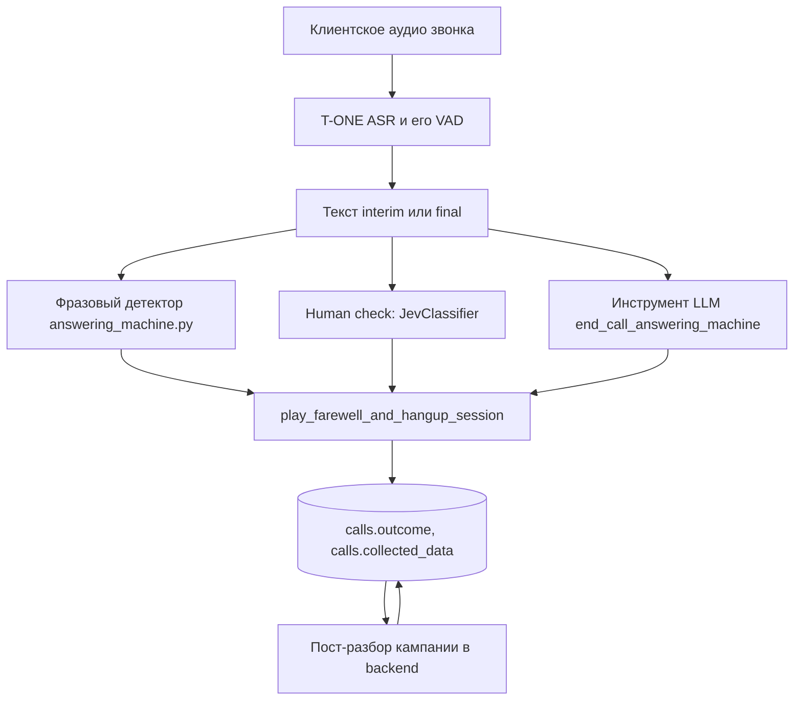
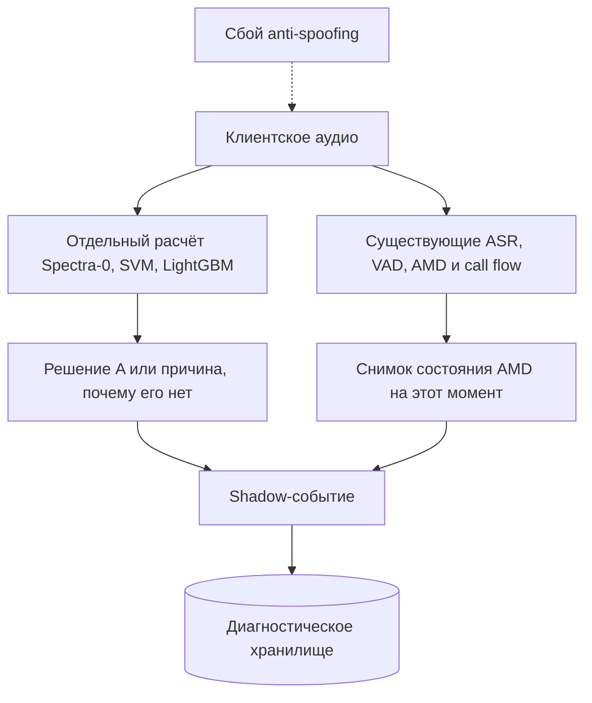

# AMD и anti-spoofing A: аудит pipeline и план shadow-интеграции

Дата разбора: 17 ноября 2026. Новых inference, обучения и подбора порогов нет. Production-код, worker, backend, call flow, AMD, ASR, VAD и hangup не менялись. База звонков в этом разборе не запрашивалась: цифры взяты из уже сохранённых CSV и из прежнего аудита отбора.

Как читать пометки:

- **Факт (код)** — поведение, которое видно в исходнике.
- **Факт (данные)** — подсчёт по сохранённой таблице, со знаменателем и периодом.
- **Вывод** — следствие из этих фактов.
- **Предположение** — то, чего файлы не доказывают.
- **Предложение** — будущая архитектура, не реализация.

Положительный класс везде один: происхождение `synthetic_tts`, `synthetic_voice_conversion` или `synthetic_playback`. Отрицательный: `human_live` или `human_recorded`. `unknown` и `mixed` в бинарный знаменатель не входят. Пороги A прежние и здесь не пересчитывались: Spectra-0 synthetic при среднем margin ниже `0.22710928916931153`, SVM new при score не ниже `0.0`, LightGBM new при score не ниже `0.3460832258410117`. Итог A — synthetic, если так сказали минимум две модели из трёх.

## 1. Executive summary

В текущем звонке автоответчик ищут по тексту ASR, а не по акустике. Рядом работают три разных сигнала, и их нельзя складывать в один «AMD»:

1. Фразовый детектор в worker пишет ключ `answering_machine_text` и может завершить звонок.
2. LLM-проверка человека (`HumanCheckController`) при режиме не `off` пишет объект `collected_data.amd`. В `shadow` она звонок не забирает. В `enforce` может задать вопрос и завершить звонок.
3. После звонка кампания ставит класс «автоответчик» и исход `answering_machine` по правилам текста и по уже записанному ключу детектора.

**Факт (данные).** На прослушанных бинарных звонках 11–12 ноября, 457 звонков длительностью не короче 15 с, фразовый детектор сработал на 48 из 134 synthetic и на 0 из 323 `human_live`. Голос A на тех же звонках: TP 109, FP 8, FN 25, TN 315. A добавляет 72 synthetic, которых детектор не отметил, и 8 ложных на `human_live`. Детектор добавляет 11 synthetic, которых A оставляет человеком. Оба пропускают 14 synthetic.

На 16 ноября тот же голос A: TP 43, FP 3, FN 15, TN 300 из 361 бинарного звонка. Флага фразового детектора в сохранённых таблицах этого дня нет. Класс кампании «автоответчик» и исход `answering_machine` есть, но это не решение детектора в момент речи.

**Вывод.** Первое synthetic-решение A нельзя делать причиной hangup. На 11–12 оно задевает 24 из 323 человеческих звонков, на 16 ноября — 15 из 303. Полный файл A этих людей в основном возвращает в human: ложных у полного A 8 и 3. Офлайн-проигрыш уже показал, что ранний synthetic потом отменяется.

**Предложение.** Следующий шаг — shadow: считать A параллельно на клиентском аудио и писать диагностику рядом с состоянием AMD, не читая этот результат в hangup, ASR, VAD и call flow. Числовой порог «какой FPR на живых людях допустим» и «на какой секунде можно завершать звонок» в данных не заданы и требуют согласования.

В бинарных когортах обоих дней нет `human_recorded`, `synthetic_voice_conversion` и `synthetic_playback`. Про обнаружение этих подтипов вывода нет.

## 2. Текущая архитектура AMD

### 2.1. Где принимается решение

**Факт (код).** Детекция идёт в `genai-agents-worker` во время звонка, по тексту реплики абонента. Акустические модели anti-spoofing в этот путь не входят.

Аудио абонента принимает streaming ASR T-ONE. Сборка — `build_asr_backend` в `genai-agents-worker/app/services/asr/factory.py`. Провайдер, отличный от `tone`, отклоняется. VAD этого ASR по умолчанию: порог активации `0.2`, минимальная речь `0.25` с, минимальная тишина `0.35` с (`ASRConfig.settings` в `app/config/schemas.py`, строки 89–98, и чтение настроек в `factory.py`, строки 51–57). Это не WebRTC VAD classical-моделей.

Событие `user_input_transcribed` обрабатывает `register_session_input_handler` в `app/flows/call_input.py`, строки 32–50. Сначала текст уходит в human check. Если human check не блокирует деловой ход, тот же текст уходит во фразовый детектор `hangup_if_answering_machine`. Детектор подписан в `app/entrypoint.py`, строки 2680–2686, и включён только когда в инструментах агента есть `end_call_answering_machine`.

### 2.2. Фразовый детектор

**Факт (код).** Логика — `hangup_if_answering_machine` в `genai-agents-worker/app/flows/answering_machine.py`, строки 290–370. Модели нет. Списки фраз и регулярные выражения лежат в том же файле.

Условия, при которых детектор переходит к завершению:

- human check не блокирует деловой сценарий;
- в режиме `amd.mode == "enforce"` срабатывают только финальная реплика и фразы операторской голосовой почты (`is_operator_voicemail_text`); остальные виды в этом режиме отсекаются на строках 304–306;
- текст не пустой, звонок ещё не помечен детектором, ветка hangup не занята;
- инструмент `end_call_answering_machine` включён у агента;
- текст попал в один из видов: ранняя машинная фраза на первых трёх финалах (`MAX_FINALS = 3`), слово «абонент» на первых двух финалах, фраза AI-ассистента, повтор одной и той же финальной реплики три раза при длине не короче пяти слов, либо набор маркеров «тянущего» бота.

Interim тоже может зажечь вид `machine`, если номер финала ещё меньше трёх и фраза совпала. После срабатывания детектор:

- ставит `_answering_machine_detected`;
- пишет ключ `answering_machine_text` через `call_signals.mark_collected`, обрезка текста до 200 символов;
- если режим AMD не `off`, дописывает в объект `amd` вложенный `legacy` с полями `source=answering_machine_detector`, `kind`, `verdict=legacy_answering_machine`, текст и `timestamp` как `time.time()`;
- вызывает hangup с `phrase_id=None`, `source=answering_machine_detector`, `force=True`.

**Факт (код).** `phrase_id=None` в таблице исходов — это исход `answering_machine` и goal status undetermined: `END_CALL_ANSWERING_MACHINE` в `app/tools/outcomes.py`, строка 80, и `outcome_for_phrase` там же. Исход пишется в сессию и уходит в публикацию звонка.

Отдельный путь того же исхода — инструмент LLM `end_call_answering_machine`. В режиме `enforce` этот инструмент убирается из списка, который видит модель: `app/tools/__init__.py`, строки 46–54. Фразовый детектор при этом не выключается, но сужается до операторской почты.

### 2.3. LLM human check

**Факт (код).** Конфиг — `AMDConfig` в `app/config/schemas.py`, строки 54–78. Режим по умолчанию `off`. Другие режимы: `shadow` и `enforce`. В `enforce` поле `legacy_policy` принудительно становится `voicemail_only`.

Установка — `human_check.install` в `app/flows/human_check.py`, строки 472–485. При `mode == "off"` runtime не создаётся. Иначе создаётся `HumanCheckRuntime` с `JevClassifier`.

Классификатор не смотрит на звук. `JevClassifier.classify` в `app/human_check/classifier.py` отправляет текст реплик на HTTP endpoint провайдера и выбирает один из заранее заданных вариантов. Вердикты подозрения: `suspected_automated`, `insufficient_evidence`, `no_suspicion`. Вердикты ответа на вопрос «вы человек?»: `human_claim`, `automated_claim`, `unclear`. Таймаут запроса по умолчанию 2 с, ответ абонента — 8 с, эпизод — 30 с, не больше двух вопросов и двух оценок подозрения.

Состояния контроллера включают `monitoring`, `assessing`, `takeover_pending`, `question_pending`, `awaiting_answer`, `classifying_answer`, `recovering`, `finished`, `resumed`, `resuming`, `recovery_failed`, `closed`. Пока контроллер в активном состоянии или уже `finished`, `blocks_business` не пускает деловой сценарий и фразовый hangup.

**Факт (код).** В `shadow`, а также при вердикте вне `suspected_automated` и `automated_claim`, контроллер возвращается в `monitoring` и звонок не забирает (`controller.py`, около строк 362–365). В `enforce` явная самоидентификация автоответчика завершает звонок вердиктом `self_reported_automated`. Иначе контроллер задаёт вопросы. Исходы human check заданы отдельно: `anti_spam_bot`, `human_check_unverified`, `human_check_no_response`, `human_check_technical_failure` (`HUMAN_CHECK_OUTCOMES` в `app/tools/outcomes.py`).

Повод для оценки — не акустика, а текстовые триггеры `SuspicionTriggers` в `app/human_check/triggers.py`: заявление о роли помощника, приём сообщения для абонента, повторы. Инструкция классификатора прямо запрещает считать ботом молчание, повторы «алло», длительность и плохой ASR.

### 2.4. Что сохраняется

**Факт (код).** На закрытии звонка `publish_call` в `app/flows/call_artifacts.py` отправляет `collected_data`, `outcome`, `end_reason`, `goal_status` и `signals`. Таблица `calls` в backend хранит это в `collected_data` JSONB и в колонке `outcome` (`genai-agents-backend/shared/src/genai_shared/db_core/models/calls.py`).

Объект human check, который runtime кладёт в ключ `amd`, содержит `schema_version`, `mode`, `source=human_check`, `verdict`, `attempts`, провайдера, модель, вопросы, ответы, оценки и ошибки. Отчётный лист читает из него `amd_mode`, `amd_source`, `amd_verdict`, `amd_attempts`, `amd_provider`, `amd_model` (`report_generator/reports/base.py`, `AMD_SHEET_HEADER`, и `amd_report_values` в `shared/.../human_check.py`).

**Факт (код).** Пост-разбор кампании — отдельный этап. Если в `collected_data` есть непустой `answering_machine_text`, ансамбль не гоняет распознавание записи и помечает причину «детектор бота распознал автоответчик» (`pipeline/ensemble.py`, `_transcription_skip_reasons`). Классификаторы HR и personal4 ставят вердикт автоответчика и по этому ключу, и по фразам транскрипта (`answering_machine_phrase` в `base.py`). Коллектор датасета считает звонок машинным, если исход в `{answering_machine, anti_spam_bot}`, класс в `{автоответчик, answering_machine, anti_spam_bot}` или ключ `answering_machine_text` истинен (`voice-dataset-collector/src/collector/samples.py`, `assign_sample`).

**Вывод.** Историческое решение фразового детектора в базе — наличие ключа `answering_machine_text`. Историческое решение LLM — поля внутри `collected_data.amd`. Класс кампании и исход — третий слой, он может появиться и без срабатывания детектора на линии. Времени решения в исследовательских CSV нет: timestamp пишется только во вложенный `legacy`, и только если режим AMD не `off`. В выгрузки он не попал.

### 2.5. VAD, который видит AMD, и VAD anti-spoofing

**Факт (код).** AMD закрывает реплику так, как её закрыл ASR: тишина по умолчанию 0.35 с и минимальная речь 0.25 с. Сегменты classical anti-spoofing закрывает другой VAD. `classical-anti-spoofing/config/config.yaml`: WebRTC VAD mode 2, кадр 20 мс, `merge_gap_ms: 300`, `min_feature_ms: 500`. В `merge_voice_frames` пауза строго длиннее 300 мс закрывает сегмент. Сегмент короче 0.5 с сохраняется, но `usable_for_features` у него 0 и в акустику модели не идёт (`src/features/pipeline.py`).

Spectra-0 считает окна по 64600 сэмплов при 16 кГц, то есть 4.0375 с (`voice-anti-spoofing-spectra0/src/run_inference.py`, `MODEL_WINDOW`). Короткий хвост добивается повтором. Это окна уже сохранённого прогона, не окна production ASR.

**Вывод.** Офлайн-реконструкция A не повторяет streaming VAD звонка. Её можно использовать как описание сохранённых сегментов и окон, не как измерение задержки production AMD.

## 3. Доступные данные

### 3.1. Что с чем стыкуется

**Факт (данные).** Бинарная когорта голоса A уже собрана в `reports/voting_combinations/call_decisions.csv`: 818 уникальных `call_id`, повторов нет, пустых score Spectra-0, SVM new и LightGBM new нет.

| Период | Звонков в бинарном счёте | Synthetic | Human | Откуда метка |
| --- | ---: | ---: | ---: | --- |
| 11–12 ноября | 457 | 134 | 323 | `data/annotations/priority_20261111_20261112_calls.csv`, все `reviewed` |
| 16 ноября | 361 | 58 | 303 | `data/annotations/day_20261116_calls.csv` после снятия споров |

Подтипы внутри бинарного счёта:

| Период | synthetic_tts | synthetic_voice_conversion | synthetic_playback | human_live | human_recorded |
| --- | ---: | ---: | ---: | ---: | ---: |
| 11–12 | 134 | 0 | 0 | 323 | 0 |
| 16 | 58 | 0 | 0 | 303 | 0 |

**Факт (данные).** Отбор аудио отрезает звонки короче 15 с: `MIN_DURATION_S = 15` в `src/collect/day_audio.py` и то же значение в yaml дней. В бинарной когорте минимальная длительность файла 15.021 с. Короткие срабатывания детектора, если они обрывали звонок раньше, в этот знаменатель не входят.

Фразовый детектор для 11–12 ноября сохранён в `reports/model_assisted_annotation_20261111_20261112/per_call_predictions.csv` колонкой `amd_live`: `yes`, если в момент прошлого отбора у звонка был ключ `answering_machine_text`. Рядом лежат `amd_campaign` (в классификации есть «автоответчик») и `amd_outcome` (исход равен `answering_machine`). Файл: 503 уникальных `call_id`, повторов нет. Все 457 бинарных звонков 11–12 в нём есть, пустого `amd_live` нет.

Тот же файл покрывает и небинарные метки 11–12: 492 размеченных звонка, из них `unknown` 23 и `mixed` 12. Ещё 11 строк предсказаний не имеют строки в файле разметки. У всех одиннадцати `amd_live=no`. В счёт они не входили.

На 16 ноября колонки `amd_live` в таблицах PACK1/PACK2 нет. `reports/callback_20261116/vote.csv` содержит `live_amd`, но это другая кампания, callback, 40 звонков, и её `call_id` не пересекаются с 361 звонком пакетов. Этот файл в сравнение пакетов не входит.

Класс и исход 16 ноября читаются из аннотаций и манифеста. После правил прежнего разбора: 392 строки аннотаций, 384 звонка, 5 звонков с двумя одинаковыми основными метками, 3 звонка с разными метками исключены целиком. У оставшихся 361 бинарного звонка метка совпала с `call_decisions.csv` у 361 из 361. Пустой `prior_classification` нет.

### 3.2. Проверка стыковки

**Факт (данные).**

| Проверка | Результат |
| --- | --- |
| Уникальность `call_id` в решениях A | 818 из 818 |
| Уникальность в предсказаниях 11–12 | 503 из 503 |
| Уникальность в разметке 11–12 | 492 из 492 |
| Бинарные 11–12 без строки предсказаний | 0 из 457 |
| Бинарные 11–12 без `amd_live` | 0 из 457 |
| Бинарные 11–12 без score трёх моделей A | 0 из 457 |
| Бинарные 16 без score трёх моделей A | 0 из 361 |
| Бинарные 16 без флага фразового детектора | 361 из 361, колонки нет |
| `unknown` и `mixed` 16 ноября в длинной таблице новых score | 0 из 20 |
| Повторы строк внутри бинарного счёта | 0 |

Новые score 16 ноября для `unknown` и `mixed` в `reports/day_20261116_model_error_overlap/per_call_predictions.csv` не лежат. Старые `call_results/svm.csv` и `lightgbm.csv` на 384 звонка есть, но это не SVM new и не LightGBM new. Под пороги A они не подставлялись.

Порог A выбирался на валидации 13 ноября. Этот разбор порог не двигал и признаки заново не отбирал. Утечки новой подгонки между 11–12 и 16 нет. Отдельное ограничение стриминга — признак `recording_duration_s` — разобрано в разделе 5, это не утечка метки между днями.

### 3.3. Чего в таблицах нет

**Факт (данные).** Нет времени срабатывания фразового детектора, нет вердикта и режима LLM human check, нет времён production VAD и нет последовательности обновлений A по каждому звонку. Прежний аудит отбора 11–12 ноября (`reports/model_assisted_annotation_20261111_20261112/data_audit.md`) зафиксировал, что ключ `amd` был у всех 520 кандидатов и как срабатывание детектора не считался. Сам JSON в исследовательские CSV не выгружался. Повторно из базы он здесь не читался.

Временная реконструкция A есть только как итог уже посчитанного проигрыша: `reports/early_ensemble/calls.csv` и `reports/early_ensemble/by_time.csv`. Полный путь решений по секундам на диск не записан.

Вторичные метки — не запрошенные подтипы происхождения. На 11–12 у 3 из 134 `synthetic_tts` стоит `ai_secretary`, у human, mixed и unknown вторичной метки нет. На 16 ноября вторичные метки есть только у `synthetic_tts`: `ai_secretary` 20, `voicemail` 8, `greeting_only` 7, считая строки аннотаций, а не уникальные звонки после снятия дублей. Как `human_recorded` или `synthetic_playback` они не использовались.

## 4. AMD и ансамбль A

### 4.1. Фразовый детектор и A, 11–12 ноября

Знаменатель — 457 бинарных звонков. `amd_live=yes` назван здесь «сработал», `no` — «не сработал». Второе не является отдельным вердиктом «человек»: детектор просто не записал ключ.

**Факт (данные).**

| Фразовый детектор | A | Звонков |
| --- | --- | ---: |
| Сработал | Synthetic | 37 |
| Сработал | Human | 11 |
| Не сработал | Synthetic | 80 |
| Не сработал | Human | 329 |
| Нет флага | Synthetic | 0 |
| Нет флага | Human | 0 |

Против метки происхождения:

| Сочетание | Synthetic, из 134 | human_live, из 323 |
| --- | ---: | ---: |
| Оба за автоответчик / synthetic | 37 | 0 |
| Только A | 72 | 8 |
| Только детектор | 11 | 0 |
| Ни один | 14 | 315 |

| Система | TP | FP | FN | TN | Recall | Precision | Specificity | FPR на human_live |
| --- | ---: | ---: | ---: | ---: | ---: | ---: | ---: | ---: |
| Фразовый детектор | 48 | 0 | 86 | 323 | 48/134 | 48/48 | 323/323 | 0/323 |
| A, полный файл | 109 | 8 | 25 | 315 | 109/134 | 109/117 | 315/323 | 8/323 |

`human_recorded` в знаменателе нет, поэтому FPR на всех бинарных human совпадает с FPR на `human_live`: 0/323 у детектора и 8/323 у A.

По подтипам, которые в данных есть:

| Метка | Звонков | Детектор сработал | A synthetic |
| --- | ---: | ---: | ---: |
| synthetic_tts | 134 | 48 | 109 |
| human_live | 323 | 0 | 8 |

**Вывод.** На этой когорте A добавляет информацию там, где детектор молчит: 72 верных synthetic и 8 ложных на живых людях. Противоречие в другую сторону — 11 звонков: детектор сработал, A сказал human, и все 11 размечены как `synthetic_tts`. Это не повод объявить одну из систем ошибкой. Это 11 случаев, где текст детектора и акустика A разошлись при метке synthetic.

**Предположение.** Нулевой FPR детектора относится к звонкам не короче 15 с, которые дошли до разметки. Если ложный hangup обрывал живой разговор раньше 15 с, этот ложный ушёл из знаменателя вместе с короткими файлами. Проверить это сохранёнными CSV нельзя.

Вне бинарного знаменателя, те же 11–12 ноября:

| Метка | Звонков | Детектор | A synthetic | A human | A без двух голосов |
| --- | ---: | ---: | ---: | ---: | ---: |
| unknown | 23 | 1 сработал, 22 нет | 3 | 16 | 4 |
| mixed | 12 | 0 | 4 | 8 | 0 |

Единственный `unknown` со срабатыванием детектора получил у A human. Четыре `unknown` без голоса A — это `no_speech` или `insufficient_speech` у classical-моделей; отсутствие решения не заменялось на human. В бинарных 457 таких пропусков нет.

### 4.2. Класс кампании и исход — не детектор

**Факт (данные).** На тех же 457 звонках 11–12 ноября класс «автоответчик» и исход `answering_machine` шире фразового ключа. Все 48 срабатываний детектора лежат и внутри класса, и внутри исхода. Обратное неверно: класс есть ещё у 35 звонков без ключа детектора, исход — ещё у 10.

| Сигнал | TP | FP | FN | TN | Recall | Precision | FPR на human_live |
| --- | ---: | ---: | ---: | ---: | ---: | ---: | ---: |
| Класс «автоответчик» | 82 | 1 | 52 | 322 | 82/134 | 82/83 | 1/323 |
| Исход `answering_machine` | 58 | 0 | 76 | 323 | 58/134 | 58/58 | 0/323 |
| Фразовый ключ | 48 | 0 | 86 | 323 | 48/134 | 48/48 | 0/323 |

Один `human_live` имеет класс «автоответчик» и не имеет ни ключа детектора, ни исхода `answering_machine`. A на `human_live` ошибается в других 8 звонках; этот один к FP голоса A не прибавлен и отдельно как ошибка A не считается.

**Факт (данные).** 16 ноября, 361 бинарный звонок. Флага детектора нет, поэтому таблица в форме запроса выглядит так:

| Фразовый детектор | A | Звонков |
| --- | --- | ---: |
| Сработал | Synthetic | нет данных |
| Сработал | Human | нет данных |
| Не сработал | Synthetic | нет данных |
| Не сработал | Human | нет данных |
| Нет флага | Synthetic | 46 |
| Нет флага | Human | 315 |

46 — это 43 TP и 3 FP голоса A. 315 — это 15 FN и 300 TN. Строка «нет флага» означает отсутствие колонки, а не решение «не автоответчик».

Класс и исход на этих 361, как отдельный пост-разбор:

| Пост-разбор | A | Звонков |
| --- | --- | ---: |
| Класс «автоответчик» | Synthetic | 22 |
| Класс «автоответчик» | Human | 10 |
| Класса нет | Synthetic | 24 |
| Класса нет | Human | 305 |
| Исход `answering_machine` | Synthetic | 20 |
| Исход `answering_machine` | Human | 9 |
| Другой исход | Synthetic | 26 |
| Другой исход | Human | 306 |

| Сигнал, 16 ноября | TP | FP | FN | TN | Recall | Precision | FPR на human_live |
| --- | ---: | ---: | ---: | ---: | ---: | ---: | ---: |
| Класс «автоответчик» | 32 | 0 | 26 | 303 | 32/58 | 32/32 | 0/303 |
| Исход `answering_machine` | 29 | 0 | 29 | 303 | 29/58 | 29/29 | 0/303 |
| A | 43 | 3 | 15 | 300 | 43/58 | 43/46 | 3/303 |

A добавляет к классу 21 synthetic и 3 `human_live`. Класс есть, а A говорит human, у 10 звонков, все 10 — `synthetic_tts`. К исходу A добавляет 23 synthetic и те же 3 `human_live`; исход есть, а A говорит human, у 9 synthetic.

**Вывод.** И на 11–12, и на 16 ноября пост-разбор и A расходятся десятками звонков. Расхождение не равно ошибке ни одной из сторон: класс кампании размечается по тексту и правилам воронки, A — по акустике происхождения. Общей таблицы «детектор против A» за оба дня нет, потому что за 16 ноября детектор не выгружен.

`unknown` после снятия трёх спорных меток: 15 звонков. `mixed`: 5. Новых score A для них в опубликованной длинной таблице нет, поэтому голос A по ним не считался. Три спорных `call_id` перечислены в `reports/voting_combinations_analysis.md` и в `excluded_calls.csv`; здесь список не повторяется.

## 5. Временная реконструкция A

Источник — уже посчитанный проигрыш `reports/early_ensemble_analysis.md` и файлы `reports/early_ensemble/calls.csv`, `by_time.csv`. Сеть Spectra-0 заново не считалась: брались сохранённые окна. SVM и LightGBM в том прогоне пересчитывались по сегментам, которые к моменту уже закончились; полный файл совпал с опубликованным A у 818 из 818 по всем трём score и по итогу. Ниже те же величины прочитаны из сохранённого `calls.csv`, без нового прогона.

Три времени не смешиваются:

- секунды от начала записи — `first_t`, `time_first_segment`, `time_first_window`;
- накопленная длительность речевых сегментов к этому моменту — `first_speech_s`;
- длительность всего файла — `duration_s` в `call_decisions.csv`.

**Факт (код).** В проигрыше SVM и LightGBM обновляются на конце уже закрытого сегмента. Пока сегмент не закрыт, classical-оценка стоит на прошлом сегменте. Spectra-0 обновляется на конце своего окна. Пауза classical VAD длиннее 300 мс закрывает сегмент, кусок короче 0.5 с в признаки не идёт. Окно Spectra-0 — 4.0375 с речи, хвост добивается.

**Факт (код).** В отобранных 200 признаках новых SVM и LightGBM есть `recording_duration_s` (`reports/origin_retrain_20261113/features.csv`). `speech_ratio`, `silence_ratio` и `snr_db` в этот список не входят: текущий `EXCLUDED_FROM_MODEL` в `classical-anti-spoofing/src/models/dataset.py` их отсекает, и в файле признаков их нет. На полном файле `recording_duration_s` равен длине файла. Проигрыш перед каждым шагом подставляет уже прошедшее время (`early_ensemble.py`, `frame["recording_duration_s"] = moment`). Без этой подстановки офлайн-шаг видел бы будущую длину.

**Предположение.** Совпадение полного файла с опубликованными score показывает, что подстановка конечной длины согласована с тем прогоном. Оно не доказывает, что каждый промежуточный шаг совпал бы со streaming-сервисом: VAD другой, буфер другой, а путь по шагам на диск не сохранён.

### 5.1. Когда появляется первая оценка

Секунды — от начала записи. Знаменатель — 134 и 323 на 11–12, 58 и 303 на 16-е. Медиана.

| Период | Класс | До первого сегмента, с | До первого окна Spectra-0, с |
| --- | --- | ---: | ---: |
| 11–12 | synthetic | 5.6 | 5.9 |
| 11–12 | human | 3.2 | 4.3 |
| 16 | synthetic | 5.3 | 5.7 |
| 16 | human | 2.8 | 4.2 |

Первое окно позже первого сегмента: окну нужно около 4 с речи. У человеческих звонков первый сегмент и первое окно наступают раньше, чем у synthetic.

### 5.2. Первые два голоса за synthetic

**Факт (данные).** Момент — конец того шага проигрыша, на котором synthetic-голосов впервые стало два. Речь — сумма длительностей сегментов к этому концу, не длина файла.

| Период | Кто дал первые два голоса | Synthetic | Human | Медиана секунды записи | Медиана речи, с |
| --- | --- | ---: | ---: | ---: | ---: |
| 11–12 | все три | 51 | 2 | 8.7 | 3.9 |
| 11–12 | SVM и LightGBM | 25 | 13 | 11.2 | 7.7 |
| 11–12 | Spectra-0 и SVM | 20 | 6 | 11.2 | 3.1 |
| 11–12 | Spectra-0 и LightGBM | 17 | 3 | 41.9 | 6.7 |
| 16 | все три | 17 | 0 | 9.9 | 2.7 |
| 16 | SVM и LightGBM | 11 | 11 | 8.5 | 5.3 |
| 16 | Spectra-0 и SVM | 6 | 4 | 10.7 | 4.5 |
| 16 | Spectra-0 и LightGBM | 13 | 0 | 39.8 | 5.5 |

**Вывод.** Самый ранний и самый частый рисунок на synthetic — все три модели сразу. На живых людях чаще остальных ранний synthetic держат SVM вместе с LightGBM: 13 из 24 ранних human на 11–12 и 11 из 15 на 16-е. Пара Spectra-0 и LightGBM срабатывает поздно, около 40 с записи, и на этих двух днях почти не берёт human.

### 5.3. Меняется ли решение

**Факт (данные).** Правило «первый synthetic и дальше не слушаем» против итога полного файла:

| Период | Synthetic пойман ранним правилом | Из них полный A тоже synthetic | Ранний synthetic, полный A human | Полный A synthetic, по пути A так и не сказал synthetic | Ранний synthetic на human |
| --- | ---: | ---: | ---: | ---: | ---: |
| 11–12 | 113 из 134 | 107 | 6 | 2 | 24 из 323 |
| 16 | 47 из 58 | 43 | 4 | 0 | 15 из 303 |

Медиана раннего synthetic на самих synthetic: 11.2 с записи и 4.3 с речи на 11–12; 10.3 с записи и 3.2 с речи на 16-е. Медиана ложного раннего на human: 11.4 с записи на 11–12 и 16.1 с на 16-е. Речь к ложному раннему на 11–12 — медиана 4.6 с, на 16-е — 7.4 с. Валидная речь окна Spectra-0 в этот момент почти совпадает с суммой сегментов: медианы 4.2 и 7.2 с.

Доля звонков, у которых A уже хотя бы раз сказал synthetic к фиксированной секунде записи. В знаменателе весь класс, не только те, кто договорил до этой секунды.

| Секунда записи | 11–12 synthetic | 11–12 human | 16 synthetic | 16 human |
| --- | ---: | ---: | ---: | ---: |
| 5 | 21/134 | 7/323 | 14/58 | 2/303 |
| 10 | 49/134 | 10/323 | 22/58 | 4/303 |
| 15 | 64/134 | 19/323 | 28/58 | 7/303 |
| 30 | 76/134 | 21/323 | 30/58 | 12/303 |
| 60 | 105/134 | 23/323 | 44/58 | 15/303 |

Состояние на той же секунде, если откат в human ещё разрешён. Это колонка `now` сохранённой кривой, не новое правило.

| Секунда записи | 11–12 synthetic сейчас | 11–12 human сейчас | 16 synthetic сейчас | 16 human сейчас |
| --- | ---: | ---: | ---: | ---: |
| 5 | 21/134 | 7/323 | 14/58 | 2/303 |
| 10 | 46/134 | 5/323 | 20/58 | 1/303 |
| 15 | 58/134 | 10/323 | 25/58 | 4/303 |
| 30 | 66/134 | 4/323 | 26/58 | 2/303 |
| 60 | 99/134 | 7/323 | 40/58 | 3/303 |

**Вывод.** Разница между «хотя бы раз» и «сейчас» — прямое свидетельство отката. На 11–12 к 30-й секунде synthetic уже звучал у 21 человеческого звонка, а в состоянии synthetic в эту секунду остаются 4. К 60-й секунде когда-либо synthetic — 23 человеческих, сейчас synthetic — 7. Полный файл в итоге ставит synthetic 8 человеческим звонкам: снимок на 60-й или 120-й секунде не равен финальному score, потому что часть файлов длиннее. Сколько раз решение переключалось внутри одного звонка, сохранённая кривая не говорит: она хранит факт «был synthetic» и состояние в сетке секунд, а не число переходов.

**Факт (данные).** Длительность файла и эта сетка — разные оси. Ни один бинарный файл не короче 15 с, поэтому полный score A, посчитанный по всему файлу, не существует на 5, 10 и 15 с записи просто потому, что файл ещё не кончился. К 30 с закончились 199 из 457 файлов 11–12 и 141 из 361 файлов 16-го. К 60 с — 367 из 457 и 296 из 361. Это не задержка streaming-решения.

Короткая речь в бинарной когорте есть, коротких файлов нет. Речь короче одного окна Spectra-0, 4.0375 с: 17 из 457 на 11–12 и 19 из 361 на 16-е. Речи короче 0.5 с в бинарном счёте нет, минимум 0.76 с. Четыре `unknown` 11–12 ноября без двух голосов A показывают другой край: `no_speech` и `insufficient_speech`, и там решение честно пустое.

## 6. Сравнение стратегий

Ни одна стратегия не внедрялась. Порог и число подтверждений по этим дням не подбирались. Лучшей по одному recall стратегия не объявляется: критерий задачи — recall автоответчиков при малом FPR на живых людях. Допустимые числа recall и FPR не заданы и требуют согласования.

Преждевременно завершённым человеческим звонком здесь называется `human_live`, который правило оборвало бы до конца файла. У полного файла такого обрыва нет: score известен, когда запись уже кончилась. Ложный synthetic полного файла — ошибка классификации, не ранний hangup.

### Сценарий A. Текущие 2 из 3 по полному файлу

Это baseline опубликованного голоса.

| Период | Recall | Precision | Specificity | FPR на human_live | FP | FN | Когда известно решение | Преждевременный обрыв human |
| --- | ---: | ---: | ---: | ---: | ---: | ---: | --- | ---: |
| 11–12, 457 | 109/134 | 109/117 | 315/323 | 8/323 | 8 | 25 | конец файла; 0 файлов короче 15 с | 0 |
| 16, 361 | 43/58 | 43/46 | 300/303 | 3/303 | 3 | 15 | то же | 0 |

Доля файлов, которые уже закончились к секунде, приведена в разделе 5.3. Это верхняя граница того, когда полный score вообще можно было бы посчитать, а не доля streaming-решений.

### Сценарий B. Обновлять модели только после закрытия речевого сегмента

**Факт (код).** Проигрыш уже так устроен для SVM и LightGBM: оценка двигается на конце сегмента classical VAD. Spectra-0 двигается на конце своего окна, в том числе внутри длинной фразы, не дожидаясь паузы 300 мс. Итог проигрыша на полном файле совпал с A у 818 из 818.

**Вывод.** Отдельного измерения «только после VAD, и Spectra тоже только после VAD» в сохранённых файлах нет. Подставлять под сценарий B цифры раннего synthetic нельзя: то правило режет по первому synthetic, а не по концу сегмента как политике. Production VAD с тишиной 0.35 с в этот проигрыш не входит.

**Предположение.** На живом звонке задержка classical-обновления будет не меньше паузы, которая закрывает сегмент ASR, и это другое число, чем 300 мс WebRTC. Пока нет shadow-логов с обоими временами, сценарий B не посчитан.

### Сценарий C. AMD как дополнительный сигнал к A

Считается только там, где фразовый ключ сохранён: 457 звонков 11–12 ноября. Два фиксированных чтения, не подбор:

- ИЛИ: synthetic, если сработал детектор или A сказал synthetic;
- И: synthetic, только если сработали оба.

| Правило | Recall | Precision | Specificity | FPR на human_live | FP | FN |
| --- | ---: | ---: | ---: | ---: | ---: | ---: |
| Только детектор | 48/134 | 48/48 | 323/323 | 0/323 | 0 | 86 |
| Только A | 109/134 | 109/117 | 315/323 | 8/323 | 8 | 25 |
| ИЛИ | 120/134 | 120/128 | 315/323 | 8/323 | 8 | 14 |
| И | 37/134 | 37/37 | 323/323 | 0/323 | 0 | 97 |

ИЛИ забирает 11 synthetic, которые детектор уже поймал, а A пропустил, и оставляет те же 8 FP, что у A. И убирает эти 8 FP и оставляет 37 из 134. Времени совместного решения нет: у детектора нет метки времени, у A есть только офлайн-проигрыш. Сколько человеческих звонков такое ИЛИ оборвало бы раньше конца файла, по таблицам не восстановить.

На 16 ноября этот сценарий не считался: нет флага детектора. Класс кампании и исход в это ИЛИ/И не подставлялись. Они известны после звонка и не являются сигналом, который можно было бы прочитать в ту же секунду, что и A.

### Сценарий D. Повторное подтверждение synthetic

**Вывод.** Это исследовательский вопрос, не выбранное правило. Число подтверждений по 11–12 и 16 ноября не подбиралось и не должно подбираться на этих звонках.

Сохранённые данные показывают, что одно подтверждение недостаточно для hangup: 6 и 4 synthetic-звонка сказали ранний synthetic и закончили полным human, а 24 и 15 человеческих звонков получили ранний synthetic. Кривая `now` показывает, что часть этих решений к 30-й и 60-й секунде уже не synthetic. Сколько подряд повторных synthetic нужно, чтобы откат стал редким, путь по шагам не сохранён, и цифра здесь не назначается.

Доля решений к 5, 10, 15, 30 и 60 с для правила «первый synthetic» — таблица «хотя бы раз» в разделе 5.3. Для правила с подтверждением такой доли нет.

## 7. Предлагаемая shadow-архитектура

**Предложение.** Anti-spoofing слушает клиентское аудио параллельно с AMD и не имеет права менять звонок. Существующий `amd.mode=shadow` для этого не подходит: это режим LLM human check по тексту. Если тот же объект потом переключат в `enforce`, контроллер начнёт задавать вопросы и завершать звонок. Акустический результат не нужно класть в `HumanCheckController` и не нужно передавать в `hangup_if_answering_machine`.

Точка наблюдения — копия клиентского аудио до того, как решение A могло бы повлиять на сценарий. Куда именно в worker врезать копию, этот документ не выбирает: подходящий шов должен читать аудио абонента и не писать в сессию hangup. Сегодня AMD видит только текст после ASR, поэтому готового интерфейса «принять score A и положить его рядом с AMD» в коде нет. Ближайшие уже существующие места хранения — ключ `collected_data` при публикации звонка и объект `amd` внутри него. Писать shadow-score в этот объект можно только отдельным полем, которое ни один hangup не читает. Надёжнее отдельный диагностический поток: падение записи тогда не проходит через публикацию звонка.

Минимальные поля события:

| Поле | Смысл |
| --- | --- |
| `call_id` | Идентификатор звонка |
| `event_timestamp` | Время записи события |
| `recording_elapsed_s` | Секунды от начала записи |
| `speech_elapsed_s` | Накопленная речь, если VAD её уже посчитал; иначе пусто |
| `spectra0_score`, `spectra0_decision` | Score и human, synthetic или пусто |
| `svm_score`, `svm_decision` | То же для SVM new |
| `lightgbm_score`, `lightgbm_decision` | То же для LightGBM new |
| `ensemble_decision` | synthetic, human или no_decision |
| `no_decision_reason` | Почему голоса нет |
| `amd_state` | Что в эту секунду известно про фразовый детектор и human check, без текста реплики |
| `model_version` | Версия трёх моделей |
| `threshold_version` | Версия трёх порогов |

В событие не входят телефон, `external_id`, ключи S3 и ссылка на аудиофайл. Текст реплики детектора тоже не нужен: для сверки достаточно факта, что ключ `answering_machine_text` уже записан, и вердикта human check, если он есть.

Правила пустых предсказаний:

- нет score модели — её decision пустой, не human;
- меньше двух непустых голосов — `ensemble_decision=no_decision`, причина `insufficient_models` или `insufficient_audio`;
- один synthetic при двух пустых не становится итоговым synthetic и не становится human;
- короче 0.5 с речи classical-модели молчат, как в текущем `min_feature_ms`;
- окно Spectra-0 короче 4.0375 с либо ждёт ещё речи, либо явно помечается как padded tail, чтобы shadow не путал его с полным окном.

Защита от дублей: ключ события — `call_id` плюс конец сегмента или окна, который это событие описывает. Повторная публикация того же конца не создаёт второе решение. Human check и так переписывает объект `amd` на каждой реплике; shadow не должен заводить новую строку на каждую такую перезапись, если акустика не обновлялась.

Задержка: бюджет в миллисекундах здесь не назначается. Для shadow достаточно, чтобы событие успевало записаться до конца звонка и не задерживало ASR. Какая задержка допустима в будущем enforce, требует согласования: по офлайн-проигрышу первые два голоса на пойманных synthetic появляются около 10–11 с записи и 3–4 с речи, но это не SLA.

Отказоустойчивость: исключение, таймаут, отсутствие модели или пустое аудио завершают только shadow-задачу. Звонок, ASR, VAD, AMD и hangup продолжаются с тем состоянием, которое у них было. Shadow не держит блокировку, которую читает `blocks_business`.

## 8. Риски и ограничения

**Факт (данные).** Когорта обрезана снизу 15 с. Recall и FPR фразового детектора на ней не описывают звонки, которые детектор мог оборвать раньше.

**Факт (данные).** Ранний synthetic A на человеческих звонках — 24/323 и 15/303. Полный A оставляет из этого 8 и 3. Правило «первый synthetic → hangup» поднимает recall и портит FPR на живых людях.

**Факт (код).** Офлайн VAD anti-spoofing и VAD звонка — разные алгоритмы и разные пороги тишины. Проигрыш не является сертификатом streaming-поведения.

**Факт (код).** Признак длины записи входит в новые classical-модели. В реальном времени известна только прошедшая длительность. Проигрыш это подставляет; любой другой расчёт, который оставит полную длину файла, будет видеть будущее.

**Факт (данные).** За 16 ноября нет сохранённого флага детектора, нет времён AMD и нет новых score A для `unknown` и `mixed`. Запрошенных подтипов `human_recorded`, `synthetic_voice_conversion` и `synthetic_playback` в бинарных когортах нет.

**Вывод.** Нулевой FPR фразового детектора на 323 `human_live` нельзя переносить на все живые звонки и на короткие звонки. Нельзя и складывать его с FPR голоса A, пока нет одной таблицы, где оба решения сняты в одну и ту же секунду.

**Предположение.** Режим LLM AMD на этих днях по выгрузкам не виден. Если часть звонков шла в `enforce`, hangup и вопросы human check уже меняли запись, которую потом слушали модели. Отличить такие звонки без полей `amd.mode` и `amd.verdict` нельзя.

## 9. Недостающие данные

Чтобы сравнить AMD и A по-настоящему, а не по соседним полям, для тех же `call_id` не хватает:

1. Флага `answering_machine_text` на пакетах 16 ноября и на следующих днях.
2. Полей `amd.mode`, `amd.verdict`, `amd.attempts`, `amd.source` и вложенного `legacy.kind` с timestamp. Текст реплики в аналитическую выгрузку не нужен.
3. Секунды от начала записи, когда детектор записал ключ, и секунды, когда human check поставил вердикт.
4. Концов речевых сегментов того VAD, который реально закрывает реплику в звонке, отдельно от офлайн WebRTC.
5. Streaming-обновлений трёх score A: score, decision и прошедшие секунды записи и речи. Сейчас есть только итог и снимок первого synthetic.
6. Новых score A для `unknown` и `mixed` 16 ноября.
7. Разметки происхождения на звонках короче 15 с, если короткий hangup вообще должен входить в оценку.
8. Подтипов `human_recorded`, `synthetic_voice_conversion`, `synthetic_playback`, если по ним нужно будет что-то утверждать.
9. Согласованного бизнес-порога: какой FPR на `human_live` допустим и можно ли завершать звонок до определённой секунды.

Пока пунктов 1–5 нет, сценарии B, C и D на 16 ноября и любая оценка задержки совместного решения остаются без измерения.

## 10. Рекомендации и следующие шаги

**Предложение.** Не включать A в hangup. Не менять пороги. Не обучать модели заново на этих днях. Не объявлять ИЛИ с детектором рабочей политикой: на 457 звонках оно сохраняет 8 ложных A и не проверено по времени.

Критерии, без которых enforce не рассматривается:

| Критерий | Что считается выполненным | Чего не хватает сейчас |
| --- | --- | --- |
| AMD и A стыкуются | Один `call_id`, оба решения, без дублей строк | На 16 ноября нет флага детектора; вердикт LLM не выгружен ни на один день |
| Новая разметка | Отдельная партия прослушанных звонков, не эти 818 | Эти дни уже использованы как описание, не как место подбора правила |
| Shadow воспроизводим | Повторный офлайн-счёт по тем же событиям даёт тот же A | Streaming-событий ещё нет |
| Задержка известна | Для решения записаны секунды записи и секунды речи | Есть только офлайн-проигрыш, и он не равен production VAD |
| FPR на живых людях измерен | Доля `human_live`, которых правило помечает synthetic, с знаменателем | Для полного A это 8/323 и 3/303; для раннего правила 24/323 и 15/303; допустимый уровень не согласован |
| Расхождения разобраны | 11 звонков «детектор да, A нет» и 8 «A да, человек» прослушаны как случаи, а не как автоматическая ошибка | Разбор случаев не делался |
| Короткие звонки и короткие сегменты | Поведение при речи короче 0.5 с и короче окна 4.0375 с записано явно | В бинарной когорте нет файлов короче 15 с; 17 и 19 звонков короче одного окна Spectra-0 есть, но это офлайн |
| Мало аудио | Нет двух голосов → no_decision, не human | Так уже устроено в очередях разметки; проигрыш `vote_of` при одном голосе сваливается в human, shadow так делать не должен |
| Нет одной модели | Событие пишется с пустым decision этой модели и с причиной | В 818 бинарных звонках дыр нет, отказ модели на них не наблюдался |
| Call flow не задет | Сбой shadow не меняет hangup, ASR, VAD и исход | Это свойство будущей реализации, сейчас его не на чем проверить |

Числовой SLA по задержке, recall и FPR сюда не подставляется. Его должен задать тот, кто отвечает за долю ложных завершений живого разговора.

Ближайший рациональный шаг — shadow на новых звонках, без влияния на трубку: писать событие из раздела 7 и рядом сохранять флаг детектора, вердикт human check и оба прошедших времени. После партии таких событий, и только на ней, можно снова сравнить A и AMD. Эти 11–12 и 16 ноября для подбора секунды hangup и числа подтверждений больше не использовать.

## Приложение. Что читалось

Код, только чтение:

- `genai-agents-worker/app/flows/answering_machine.py`, `call_input.py`, `human_check.py`, `end_call.py`, `call_artifacts.py`, `call_signals.py`
- `genai-agents-worker/app/human_check/controller.py`, `classifier.py`, `triggers.py`, `types.py`
- `genai-agents-worker/app/config/schemas.py`, `app/entrypoint.py`, `app/services/asr/factory.py`, `app/tools/outcomes.py`, `app/tools/__init__.py`
- `genai-agents-backend` модели `calls`, `human_check.py`, `pipeline/ensemble.py`, `reports/base.py`, фразовые правила кампаний
- `voice-dataset-collector/src/collector/samples.py`
- `classical-anti-spoofing` `config/config.yaml`, `src/audio/segmentation.py`, `src/features/pipeline.py`, `src/aggregation/call_aggregation.py`, `src/models/dataset.py`
- `voice-anti-spoofing-spectra0/src/run_inference.py` — длина окна
- `synthetic-speech-dataset/src/research/model_assisted_annotation/early_ensemble.py`, `rules.py`, `voting_combinations.py`, `build_report.py`
- `synthetic-speech-dataset/src/collect/day_audio.py`

Сохранённые результаты:

- `reports/voting_combinations/call_decisions.csv`, `reports/voting_combinations_analysis.md`
- `reports/early_ensemble/calls.csv`, `by_time.csv`, `reports/early_ensemble_analysis.md`
- `reports/model_assisted_annotation_20261111_20261112/per_call_predictions.csv`, `data_audit.md`
- `reports/day_20261116_model_error_overlap/per_call_predictions.csv`
- `reports/origin_retrain_20261113/features.csv`
- `data/annotations/priority_20261111_20261112_calls.csv`, `data/annotations/day_20261116_calls.csv`
- `reports/callback_20261116/vote.csv` — только чтобы убедиться, что это другая кампания

Создан этот файл: `reports/amd_vs_ensemble_pipeline_analysis.md`. Других репозиториев документ не касается. Код не менялся.
