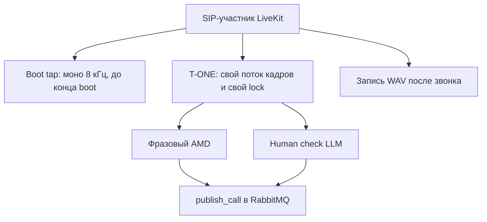
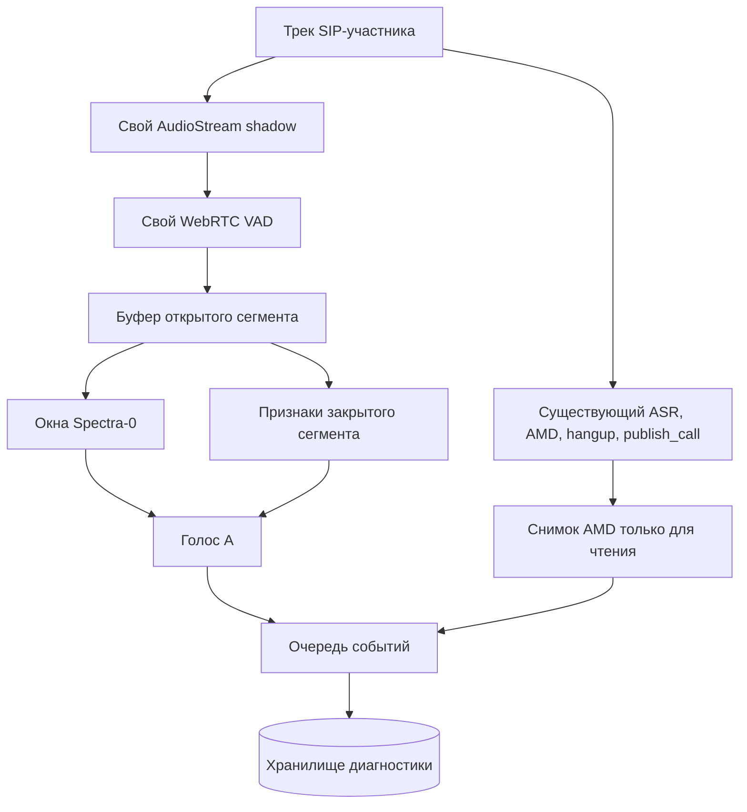

# Техническая спецификация: Shadow Anti-Spoofing

Дата: 17 ноября 2026. Это спецификация. Код, конфигурация, пороги и call flow не менялись. Inference и обучение не запускались.

Как читать пометки:

- **Факт (код)** — поведение, которое видно в исходнике.
- **Факт (исследование)** — уже опубликованный замер или таблица. Это не обещание времени на сервере воркера.
- **Предложение** — архитектура, которую ещё предстоит реализовать.
- **Неизвестно** — код этого не подтверждает.

Пороги и состав ансамбля A в этом документе не пересматриваются.

## 1. Executive Summary

Акустический anti-spoofing должен слушать только аудио клиента, считать ансамбль A и писать диагностические события. Он не вызывает hangup, не пишет в `collected_data`, не берёт блокировки ASR и human check и не участвует в `publish_call`.

**Факт (код).** Сегодняшний AMD смотрит на текст T-ONE, а не на акустику. Режим `amd.mode=shadow` — это режим LLM Human Check. Он не является режимом для Spectra-0, SVM и LightGBM.

**Факт (код).** Единственный явный tap клиентского RTP в воркере — `tap_remote_audio`. По умолчанию он останавливается, когда звонок выходит из стадии boot. Готовых речевых PCM-сегментов, которые можно было бы читать всю длину звонка, воркер наружу не отдаёт. `calls.id` во время разговора воркеру не возвращается: публикация звонка уходит в RabbitMQ и отвечает только успехом или неуспехом. Имя комнаты, которым воркер пользуется как `external_id`, содержит телефон и в аналитическое событие попадать не должно.

**Предложение.** Рекомендуемый вариант — отдельная задача с собственным `AudioStream` на SIP-участнике, собственным WebRTC VAD и собственной очередью inference. Второй вариант, «читать уже существующие сегменты», подтверждённой шины сегментов не имеет. Включать его можно только после появления такой шины, и эта шина не должна быть внутренним буфером ASR.

Enforce, смена порогов и hangup по голосу A в эту спецификацию не входят.

## 2. Current Architecture

### 2.1. Откуда берётся аудио клиента

**Факт (код).** Входящий абонент SIP ожидается как участник `PARTICIPANT_KIND_SIP` (`wait_for_sip_participant` в `genai-agents-worker/app/entrypoint.py`). Подписка на трек — `register_track_subscribed_handler` в том же файле. Аудиотрек любого подписанного участника записывается в `participant_ref` и запускает `tap_remote_audio`, если предыдущий tap уже закончился. Проверки `participant.kind == SIP` перед открытием потока в этом обработчике нет.

**Факт (код).** `tap_remote_audio` в `app/flows/call_boot.py` открывает `rtc.AudioStream(track, sample_rate=8000, num_channels=1)`. Кадры пишутся в boot-sink и в boot VAD, пока стадия равна boot. Флаг `OBSERVABILITY_KEEP_SIP_AUDIO_TAP_ENABLED` по умолчанию `false` (`app/settings.py`). При выключенном флаге tap делает `return`, как только стадия звонка уходит из boot, и закрывает поток.

**Факт (код).** T-ONE живёт отдельно от этого tap. `ToneStreamingSTT.stream` создаёт `ToneSpeechStream` (`app/services/asr/tone/streaming.py`). Поток читает кадры из собственного input channel LiveKit, режет их по `CHUNK_SAMPLES = 1440` при 8 кГц и держит `asyncio.Lock` с именем `_infer_lock` на время распознавания. Если у кадра больше одного канала, `_frame_to_8k` усредняет каналы. Boot-tap запрашивает уже один канал, поэтому этот усредняющий путь boot-tap не проходит.

**Неизвестно.** Можно ли на одном и том же `rtc.Track` держать второй `AudioStream` всю длину звонка, не отнимая кадры у ASR и не меняя их порядок. В коде воркера одновременно открыт один boot-поток, и тот не на весь звонок. Поведение LiveKit при двух читателях спецификация не выводит из исходника.

### 2.2. Как offline выбирает канал клиента

**Факт (код).** Запись звонка, с которой считались сохранённые score, — стерео WAV. Канал абонента выбирается так:

- один канал в файле — индекс 0;
- `external_id` с префиксом `excel-` — индекс 1;
- иначе индекс 0.

Это `client_channel` в `synthetic-speech-dataset/src/collect/identity.py` и `client_channel_index` в `src/data/selector.py`. `select_client_channel` в `classical-anti-spoofing/src/audio/loader.py` берёт ровно один столбец и каналы не смешивает. В манифест пишется уже номер канала, не `external_id`.

**Факт (код).** В живом SIP-потоке воркер не режет стереофайл. Он подписывается на аудиотрек удалённого участника и просит моно 8 кГц. Роль «клиент» в онлайне — это SIP-участник, а не столбец 0 стерео WAV. Запись для датасета собирается позже: egress или recorder кладёт файл в S3 по имени комнаты (`app/utils/call_recording.py`). Сверка «моно RTP совпал со столбцом 0 файла» в коде не сделана.

**Вывод.** Shadow не должен повторять правило `excel-` на живом треке. Это правило про импортированные стереофайлы. Для звонка нужен трек SIP-участника, уже выбранного `wait_for_participant`.

### 2.3. ASR, AMD и публикация

**Факт (код).** Фразовый AMD — `hangup_if_answering_machine` в `app/flows/answering_machine.py`. Он читает текст `user_input_transcribed`, пишет ключ `answering_machine_text` и может вызвать hangup. Human check — `HumanCheckController` и `JevClassifier`. При `amd.mode=off` runtime не создаётся. При `shadow` контроллер пишет метаданные и звонок не забирает. При `enforce` может задать вопрос и завершить звонок. Подробности и цифры сравнения с ансамблем A лежат в `reports/amd_vs_ensemble_pipeline_analysis.md`.

**Факт (код).** `publish_call` внутри `flush_and_save_call_artifacts` (`app/flows/call_artifacts.py`) собирает `collected_data` через `build_collected_data` и вызывает `publish_create_call` (`app/utils/calls.py`). Функция возвращает `bool`. Идентификатор строки `calls.id` в воркер не приходит. `external_id` публикации — имя комнаты. `request_id` — отдельный UUID (`new_request_id` в `app/utils/request_context.py`).

**Факт (код).** Исключение в задаче, созданной `_create_task_logged` (`app/runtime.py`), пишется в лог и не отменяет звонок само по себе. Это свойство конкретной задачи, а не разрешение делить с ней блокировку или `collected_data`. `_infer_lock` ASR и состояние human check shadow использовать не должен.

## 3. Existing AMD vs Acoustic Anti-Spoofing

| | Фразовый AMD и Human Check | Ансамбль A |
| --- | --- | --- |
| Вход | Текст ASR | Аудио клиента |
| Модели | Списки фраз и LLM по репликам | Spectra-0, SVM new, LightGBM new |
| VAD | VAD T-ONE, по умолчанию тишина 0.35 с, речь от 0.25 с | WebRTC VAD mode 2, кадр 20 мс, пауза длиннее 300 мс закрывает сегмент |
| Когда обновляется | На interim или final тексте | Окно Spectra-0 4.0375 с речи; classical — после сегмента не короче 0.5 с |
| Куда пишет | `collected_data` и исход звонка | Сейчас никуда в звонке |
| Может завершить звонок | Да, если инструмент включён или режим `enforce` | В этой спецификации нет |

**Факт (исследование).** На 457 бинарных звонках 11–12 ноября фразовый ключ и полный голос A расходятся: A добавляет 72 synthetic и 8 ложных на `human_live`, детектор добавляет 11 synthetic, которых A называет human. Первое synthetic-решение A по пути задевает 24 из 323 и 15 из 303 человеческих звонков. Поэтому shadow не имеет права превращать свой результат в hangup. Офлайн-проигрыш этих чисел не равен streaming на VAD T-ONE.

**Факт (исследование).** В бинарных когортах 11–12 и 16 ноября нет `human_recorded`, `synthetic_voice_conversion` и `synthetic_playback`. Спецификация не обещает обнаружение этих подтипов.

## 4. Integration Options

### 4.1. Вариант 1. Отдельный поток аудио

**Предложение.** На старте звонка, после того как известен SIP-участник и его аудиотрек, shadow открывает свой `AudioStream` с теми же параметрами, что boot-tap: 8000 Гц, 1 канал. Задача живёт до конца звонка или до своей ошибки. Кадры копятся только в буфере shadow. ASR, boot-tap и human check этот буфер не видят.

Преимущества:

- вход совпадает с тем, что воркер уже считает клиентским RTP: моно 8 кГц с трека участника;
- свой lifecycle: падение задачи не стоит в `await` у `publish_call`;
- свой VAD можно сделать копией offline WebRTC, не читая VAD T-ONE;
- boot-tap можно не удлинять и не менять его условие остановки.

Недостатки и риски:

- второй читатель одного трека кодом не проверен;
- обработчик `track_subscribed` сейчас не фильтрует kind и может запомнить не тот аудиотрек, если подпишется другой участник; shadow должен брать трек именно SIP-участника, а не последнее значение `audio_track`;
- живой моно-трек ещё не сверен со столбцом 0 стерео WAV;
- буфер и inference сидят в процессе воркера и делят CPU с ASR.

Точка интеграции, если вариант примут: новая задача рядом с уже существующим `create_task(tap_remote_audio(...))`, но не внутри `tap_remote_audio` и не вместо него. Пока флаг shadow выключен, эта задача не создаётся.

### 4.2. Вариант 2. Потребитель уже существующих сегментов

**Факт (код).** Речевых PCM-сегментов на всю длину звонка воркер не публикует.

- Boot-tap отдаёт кадры только до конца boot, если не включён `OBSERVABILITY_KEEP_SIP_AUDIO_TAP_ENABLED`.
- T-ONE после VAD публикует текст, не аудио сегмента. Его `_infer_lock` принадлежит распознаванию.
- Classical-сегменты и окна Spectra-0 существуют в offline-скриптах поверх WAV, не в процессе звонка.
- Файл записи появляется к финализации и лежит в S3 под именем комнаты. Читать его в аналитике по ключу S3 эта спецификация запрещает. Ждать файл — значит считать A после звонка, а не параллельно.

Преимущества, если бы шина сегментов уже была: не нужен второй `AudioStream`, один раз снятый кадр можно отдать и ASR, и shadow.

Недостатки:

- такой шины нет;
- сегменты ASR закрываются другим VAD, чем offline-модели, и подмена одного другим ломает сверку с сохранёнными score;
- включение `KEEP_SIP_AUDIO_TAP` на весь звонок меняет существующий boot-путь, хотя флаг уже есть; это всё равно изменение поведения production-tap, а не отдельный потребитель;
- чтение финального WAV не выполняет требование параллельности и тянет за собой имя объекта хранения.

**Вывод.** Вариант 2 сейчас не из чего собрать, не задев ASR или boot-tap. Он остаётся запасным только если команда сначала заведёт отдельную шину копий кадров, которую ASR не ждёт.

### 4.3. Рекомендация

**Предложение.** Брать вариант 1. Вариант 2 не реализовывать, пока нет независимой копии кадров.

Обоснование: цель shadow — тот же клиентский звук, что уходит в запись абонента, и тот же offline VAD, на котором зафиксированы пороги. ASR этот звук уже превратил в текст к моменту AMD. Потреблять текст или сегменты ASR значит считать другую задачу.

Риск, который надо закрыть до кода: эксперимент на одном тестовом звонке, что второй `AudioStream` не глушит ASR. Если LiveKit отдаёт кадры только одному читателю, вариант 1 в этой форме не работает. Тогда нужен отдельный форк кадров в одном читателе, и этот форк всё равно не должен стоять на пути распознавания: очередь с отбрасыванием, а не общая блокировка. Это развилка, а не повод включить enforce.

## 5. Recommended Shadow Architecture

**Предложение.** Компонент `ShadowAntiSpoof` — одна asyncio-задача на звонок плюс пул inference вне event loop. Задача не импортируется в `hangup_if_answering_machine` и не регистрируется в `HumanCheckController`.

Граница ответственности:

- вход — кадры своего потока;
- выход — события раздела 8;
- запрещено вызывать hangup, `mark_collected`, `blocks_business`, `publish_create_call` и ждать их;
- чтение флага `_answering_machine_detected` и уже записанного объекта `amd` допустимо только как снимок в событие; исключение чтения превращается в пустой `amd_state`, не в ошибку звонка.

**Предложение.** Связка с будущим `call_id` не использует имя комнаты. На старте shadow генерирует `shadow_session_id` как UUID. События до публикации звонка ключуются им. Рядом, в операционном сообщении, которое не попадает в исследовательскую выгрузку, backend связывает этот UUID с `calls.id` после создания строки звонка. В таблице, которую читает исследование, остаётся только `call_id`. Поле `request_id` публикации — тоже UUID и уже едет в `publish_create_call`; его можно использовать как этот ключ, если команда подтвердит, что аналитическая выгрузка умеет заменить его на `calls.id` и нигде не хранит пару с телефоном. Пока замена не сделана, в отчёты не пишется ни `request_id`, ни имя комнаты.

## 6. Audio Input and Preprocessing

**Предложение.** Контракт preprocessing повторяет offline-скрипты, а не VAD T-ONE.

| Шаг | Контракт | Откуда известно |
| --- | --- | --- |
| Вход | Моно PCM SIP-участника, 8000 Гц, 1 канал | `tap_remote_audio` |
| Каналы | Не усреднять и не смешивать | `select_client_channel` |
| VAD | WebRTC mode 2, кадр 20 мс, пауза строго длиннее 300 мс закрывает сегмент | `classical-anti-spoofing/config/config.yaml`, `merge_voice_frames` |
| Classical | Сегмент короче 0.5 с или с RMS ниже порога offline не даёт признаков | `min_feature_ms: 500` |
| Spectra-0 | Речь сегмента, resample до 16 кГц, окно 64600 сэмплов = 4.0375 с | `run_inference.py`, `MODEL_WINDOW` |
| Хвост окна | Повтор только внутри того же сегмента, без склейки соседних сегментов | `make_segment_windows` |
| Margin | `bonafide_logit - spoof_logit` | `spectra_runner.py` |
| Score звонка Spectra-0 | Среднее margin всех окон с начала звонка | тот же runner и правило A |
| Длина записи в признаках | Прошедшие секунды на момент закрытия сегмента, не длина будущего файла | `features.csv` содержит `recording_duration_s`; проигрыш подставляет elapsed |

**Факт (код).** В отобранных 200 признаках SVM new и LightGBM new есть `recording_duration_s`. `speech_ratio`, `silence_ratio` и `snr_db` в этот список не входят. Streaming-вектор должен содержать ровно столбцы bundle и подставлять в `recording_duration_s` уже прошедшее время. Считать speech ratio по ещё не законченному файлу и молча класть его в модель не нужно: модель этот столбец не заказывает, а расхождение с offline будет трудно заметить.

**Неизвестно.** Совпадёт ли моно 8 кГц LiveKit с каналом 0 стерео WAV после resample и VAD. Это пункт плана проверки, не текущий факт.

Буфер: хранить PCM открытого сегмента и уже посчитанные агрегаты закрытых сегментов. Весь звонок сырым звуком в памяти не держать. 25 звонков по 10 минут моно 8 кГц, 16 бит — около 480 МБ, если хранить сырьё целиком; спецификация этого не предлагает.

## 7. Ensemble Inference Contract

Состав фиксирован: Spectra-0, SVM new, LightGBM new. Другие модели в голос не входят.

Пороги не меняются:

- Spectra-0 synthetic, если средний margin строго меньше `0.22710928916931153`;
- SVM synthetic, если `decision_function` не ниже `0.0`;
- LightGBM synthetic, если `predict_proba` класса synthetic не ниже `0.3460832258410117`.

**Предложение.** Голос строится только из моделей, у которых в этот момент есть конечный score.

1. Число валидных голосов меньше 2 → `ensemble_decision = no_decision`.
2. Валидных голосов хотя бы 2 и среди них хотя бы 2 synthetic → `synthetic`.
3. Валидных голосов хотя бы 2 и synthetic среди них меньше 2 → `human`.

Отдельные следствия, их нельзя свернуть в «пустое значит human»:

- один synthetic и два пустых результата → `no_decision`, не synthetic и не human;
- synthetic и human при третьем пустом → валидных голоса два, synthetic один → `human`;
- ошибка или timeout одной модели очищает только её score и decision;
- отсутствие аудио не создаёт human.

Score модели — число или null. Decision модели — `synthetic`, `human` или null. Пустая строка и слово `human` для отсутствующей модели запрещены.

Версии, которые пишутся в событие, указывают на уже обученные файлы и на эти три константы. Подбор нового порога спецификация не описывает.

Offline-проигрыш обновлял classical на конце сегмента и Spectra-0 на конце окна, а полный файл совпал с опубликованным A на 818 из 818. Это факт исследования, не доказательство, что streaming на RTP даст те же score. Контракт выше задаёт, с чем streaming потом сверять, а не утверждает, что сверка уже пройдена.

## 8. Event Schema

**Предложение.** Одно событие — один момент, когда изменился набор валидных голосов или звонок закончился. Кадр RTP событием не является.

### 8.1. Поля

| Поле | Тип | Null | Значения |
| --- | --- | --- | --- |
| `schema_version` | int | нет | `1` |
| `shadow_session_id` | UUID string | нет | ключ процесса звонка до подмены на `call_id` |
| `call_id` | UUID string | да, пока строка звонка не создана | только `calls.id` |
| `event_timestamp` | string, ISO-8601 с зоной | нет | время записи события |
| `recording_elapsed_s` | number | нет | секунды от начала клиентского аудио |
| `speech_elapsed_s` | number | да | сумма уже закрытых речевых сегментов; null, если VAD ещё ничего не закрыл |
| `update_kind` | string | нет | `spectra_window`, `classical_segment`, `call_end` |
| `update_end_ms` | int | нет | конец окна или сегмента в миллисекундах записи; для `call_end` — текущий elapsed |
| `spectra0_score` | number | да | средний margin |
| `spectra0_decision` | string | да | `synthetic` или `human` |
| `svm_score` | number | да | decision function |
| `svm_decision` | string | да | `synthetic` или `human` |
| `lightgbm_score` | number | да | вероятность класса synthetic |
| `lightgbm_decision` | string | да | `synthetic` или `human` |
| `ensemble_decision` | string | нет | `synthetic`, `human`, `no_decision` |
| `no_decision_reason` | string | да | см. ниже; null, когда решение `synthetic` или `human` |
| `valid_vote_count` | int | нет | 0, 1, 2 или 3 |
| `amd_state` | object | нет | снимок ниже; внутри поля могут быть null |
| `model_version` | string | нет | идентификатор трёх файлов весов |
| `threshold_version` | string | нет | идентификатор трёх констант раздела 7 |
| `padded_tail` | bool | да | true, если последнее окно Spectra-0 добито повтором |
| `dropped_audio` | bool | нет | true, если с прошлого события очередь сбрасывала кадры |

`amd_state`:

| Поле | Тип | Null | Значения |
| --- | --- | --- | --- |
| `phrase_detector` | string | да | `fired`, `not_fired`; null, если снимок не прочитался |
| `human_check_mode` | string | да | `off`, `shadow`, `enforce` |
| `human_check_verdict` | string | да | вердикт, который контроллер уже записал, без текста реплики |
| `snapshot_status` | string | нет | `ok` или `unavailable` |

Текст транскрипта, URL аудио, ключ и bucket S3, телефон, `external_id`, `msisdn` и имя комнаты в событие не входят. В `human_check_verdict` не копируется поле `text` из legacy-объекта.

`no_decision_reason`, когда `ensemble_decision = no_decision`:

| Причина | Когда |
| --- | --- |
| `no_client_audio` | к моменту события не было ни одного кадра |
| `insufficient_audio` | кадры были, валидных голосов меньше 2, модели не падали |
| `insufficient_models` | хотя бы у одной модели нет score из-за ошибки, а оставшихся голосов меньше 2 |
| `timeout` | последний пропуск вызван таймаутом inference, голосов меньше 2 |
| `model_error` | последний пропуск вызван исключением модели, голосов меньше 2 |

Если одновременно есть и timeout, и нехватка звука, пишется причина последнего обновления, которое не дало голос. Оба факта не склеиваются в `human`.

`human` и `no_decision` различаются полем `ensemble_decision`, не пустым score. У `human` поле `no_decision_reason` всегда null и `valid_vote_count` не меньше 2.

### 8.2. Когда писать событие

- закрылось окно Spectra-0, включая добитый хвост: `update_kind=spectra_window`, `update_end_ms` — конец валидной речи окна, не длина добивки;
- закрылся сегмент, пригодный для classical-признаков, и SVM со LightGBM либо посчитались, либо явно отказали: `classical_segment`;
- звонок закончился: одно событие `call_end` с последними известными score.

Сегмент короче 0.5 с событие classical не создаёт. Окно короче 4.0375 с без явной пометки `padded_tail=true` не считается валидным голосом Spectra-0.

### 8.3. Дедупликация

**Предложение.** Ключ идемпотентности: `shadow_session_id` или уже подставленный `call_id`, плюс `update_kind`, плюс `update_end_ms`. Повтор того же ключа не создаёт вторую строку. Если повтор несёт те же score, он отбрасывается. Если повтор того же ключа несёт другие score, это ошибка записи, а не новый голос: хранится первая успешная строка, в лог shadow пишется конфликт без аудио и без телефона.

Почему ключа `call_id + window_end` недостаточно:

- во время звонка `call_id` ещё может быть null;
- конец окна Spectra-0 и конец classical-сегмента могут совпасть в одну миллисекунду, это два разных обновления;
- `window_end` в секундах с плавающей точкой даёт ложные отличия одного и того же окна;
- добитый хвост имеет конец валидной речи короче 4.0375 с; ключ по концу добитого тензора разойдётся с offline-полем `window_end_sec`.

`call_id + update_kind + update_end_ms` эти случаи разделяет. Один только `call_id + window_end` — нет.

Повторный запуск обработки того же звонка после падения процесса создаёт новый `shadow_session_id`, если старый не был сохранён. Склеивать его со старым по имени комнаты нельзя: имя комнаты в ключ не входит. Несведённые сессии остаются на `shadow_session_id` до операционной склейки и в отчёт с телефонами не попадают.

## 9. Lifecycle and Failure Handling

**Предложение.** Главный цикл звонка нигде не делает `await` на задачу shadow. Отмена звонка отменяет задачу shadow, но не ждёт её inference дольше, чем это уже делает собственный shutdown воркера для прочих фоновых задач. `publish_call` выполняется так же, как сейчас.

| Момент | Поведение shadow | Звонок |
| --- | --- | --- |
| Старт звонка | Если флаг выключен, задача не создаётся. Если включён, создаётся задача и `shadow_session_id`. Модели грузятся в свой пул, ошибка загрузки завершает только shadow | Идёт обычный boot |
| Первый кадр | Фиксируется ноль `recording_elapsed_s`. Событие ещё не пишется, пока нет закрытого окна или сегмента | ASR получает свои кадры своим путём |
| Закрытие сегмента VAD shadow | Считаются признаки, если сегмент не короче 0.5 с. Inference уходит в пул и не держит event loop | Не ждёт |
| Конец окна Spectra-0 | Считается окно, средний margin обновляется, пишется событие | Не ждёт |
| Конец звонка | Ставится `call_end`. Незаконченный inference помечается timeout или отменяется. Буфер сбрасывается | `publish_call` не ждёт этого события |
| Нет клиентского аудио | Одно событие `call_end` с `no_decision` и `no_client_audio`, если к концу так и не было кадров | Завершается своей логикой |
| Timeout inference | Score этой модели null, reason `timeout`, если голосов меньше 2. Следующее окно не ждёт зависший расчёт: расчёт бросается | Не ждёт |
| Ошибка модели | То же с `model_error`. Процесс воркера не роняется исключением наружу задачи | Не ждёт |
| Ошибка записи события | Повтор внутри shadow с ограничением попыток. После исчерпания событие теряется, звонок жив. Потеря считается метрикой | `publish_call` не повторяет это событие |
| Падение воркера | События, уже принятые хранилищем, остаются. Память задачи пропадает. Догонять её из RTP нечем | Как и любой другой процесс воркера |
| Повторная обработка | Новый `shadow_session_id`, старые строки не переписываются | Не запускается заново из-за shadow |

Снимок AMD читается в момент формирования события. Он диагностический: `fired`, если к этому моменту уже выставлен флаг детектора, иначе `not_fired`. Режим и вердикт human check берутся из уже лежащего в сессии объекта, если он есть. При `mode=off` runtime human check не создаётся, тогда mode в снимке — `off`, verdict null.

Очередь кадров ограничена. При переполнении новые кадры текущего открытого сегмента отбрасываются, `dropped_audio=true` на следующем событии, VAD этого дырявого сегмента не выдаёт classical-голос. Так shadow не копит минуты звука и не тормозит цикл, который кадры принимает. ASR при этом читает свой поток; отбрасывание в shadow его не касается, если вариант 1 с двумя читателями подтвердится.

## 10. Concurrency and Resource Risks

Заказанная конкуренция — 25 одновременных звонков. Бюджет задержки здесь не задаётся.

**Факт (исследование).** На машине, где считались отчёты `cpu_inference_analysis.md` и `cpu_gpu_inference_200.md`, одно окно Spectra-0 на CPU в 1 поток имело медиану около 1.4 с при длине окна 4.0375 с. На 4 потоках PyTorch медиана одного окна падала примерно до 0.6–0.8 с. Это четыре потока одного звонка, не 25 звонков. На GPU той же машины медиана окна была около 27 мс на 1682 окнах, класс совпал с сохранённым у 200 из 200. Признаки одного закрытого сегмента classical: медиана около 157 мс, отдельный длинный сегмент — сотни миллисекунд. Сам вызов SVM и LightGBM по готовой строке — около 1 мс. Это время исследовательского процесса, не сервера воркера. Другие нагрузки в тот замер не входили.

**Неизвестно.** Сколько CPU и есть ли GPU у процесса воркера, сколько звонков уже сидит на одном ядре из-за ASR, и выровняются ли 25 окон в одну и ту же секунду.

Риски при 25 звонках, без числового SLA:

- 25 задач shadow и до 25 одновременных окон Spectra-0, если все клиенты говорят синхронно;
- память моделей: один экземпляр Spectra-0 на процесс лучше 25 копий; классические bundle тоже одни на процесс;
- сырой буфер, если его не ограничить открытым сегментом;
- очередь inference без верхнего предела превратится в хвост после окончания звонка;
- четыре потока PyTorch на каждый из 25 звонков перегрузят машину; пул потоков должен быть общим;
- запись событий не должна использовать соединение, которым `publish_call` публикует звонок, иначе ошибка shadow может задеть чужой канал.

Что измерить до включения на боевых звонках, отдельным разрешением и не на этой спецификации:

- время кадра до возврата в цикл чтения shadow при 25 синтетических потоках;
- очередь inference: глубина, число timeout, число сброшенных сегментов;
- RSS процесса с загруженными моделями и с 25 буферами;
- задержка T-ONE и время до `publish_call` с выключенным и включённым shadow на одних и тех же тестовых звонках;
- совпадение score с offline на записанном клиентском канале.

Пока этих замеров нет, утверждать, что 25 звонков «успевают», нельзя. Утверждать можно только то, что shadow не имеет права ждать эти 1.4 с внутри цикла ASR.

## 11. Observability

**Предложение.** Метрики без идентификаторов абонента:

- число активных задач shadow;
- число событий по `ensemble_decision` и по `no_decision_reason`;
- число timeout, ошибок модели и ошибок записи;
- глубина очереди inference и число отброшенных кадров;
- число конфликтов дедупликации;
- число снимков AMD со `snapshot_status=unavailable`.

Лог задачи содержит `shadow_session_id` и, когда он уже есть, `call_id`. Телефон, комнату, текст реплики и путь к аудио лог не содержит. Существующий `_create_task_logged` показывает образец: исключение задачи логируется и не становится исключением звонка. Shadow повторяет эту изоляцию и не пишет в общий `collected_data`, потому что тот уходит в `publish_call`.

Сверка с разметкой делается по `call_id` после подмены. До подмены события в исследовательский отчёт не выгружаются.

## 12. Validation Plan

Проверки ниже не запускаются этой спецификацией. Они требуют отдельного разрешения, потому что часть из них — inference, а часть — тестовый звонок.

1. Канал клиента. На тестовом стерео WAV столбец, выбранный `select_client_channel`, сравнивается с моно, которое shadow снял с SIP-участника того же звонка. Критерий — совпадение PCM после приведения к одной частоте, либо явный список расхождений. Правило `excel-` на живом SIP не применяется.
2. Preprocessing. Одинаковые VAD-интервалы, те же окна 64600 сэмплов, тот же повтор хвоста внутри сегмента, тот же `recording_elapsed_s` вместо длины файла. Расхождение с offline фиксируется, а не подгоняется новым порогом.
3. Модели по отдельности. Score Spectra-0, SVM и LightGBM на том же звуке сравниваются с уже сохранёнными score там, где они есть. Новый полный прогон когорты не является шагом по умолчанию.
4. Голос 2 из 3. На фиксированных тройках решений проверяются все сочетания synthetic и human. Ожидание совпадает с разделом 7.
5. `no_decision`. Наборы: нет аудио; один голос; два пустых и один synthetic; ошибка третьей модели при одном оставшемся голосе. Ни один из них не становится synthetic и не становится human, пока валидных голосов меньше двух.
6. Дедупликация. Повтор того же `update_kind` и `update_end_ms` не даёт второй строки. Окно и сегмент с одним `update_end_ms` дают две строки. Плавающий `window_end` в секундах ключом не служит.
7. Timeout и ошибка модели. Исключение и искусственный timeout очищают только эту модель. Задача звонка и `publish_call` завершаются без ожидания shadow.
8. ASR и call flow. На тестовом звонке с включённым и выключенным shadow сравниваются факт публикации, исход, наличие ключа `answering_machine_text` и отсутствие новых полей в `collected_data`. Текст реплик в отчёт проверки не копируется.
9. Завершение задач. После hangup, после обрыва SIP и после ошибки загрузки модели не остаётся висящей задачи и не растёт буфер. `call_end` либо записан, либо потеря учтена метрикой.
10. Сверка с разметкой. После появления новых прослушанных `call_id` события shadow стыкуются с меткой происхождения. `unknown` и `mixed` не входят в бинарный знаменатель. Подтипы, которых нет в разметке, не интерпретируются.

Отдельно, до пункта 8 на боевом трафике: один тестовый звонок с двумя `AudioStream`. Если ASR теряет кадры, вариант 1 в текущем виде останавливается.

## 13. Open Questions

Решения команды, без которых реализацию не начинать:

1. Второй `AudioStream` на том же треке не мешает T-ONE или нет. Это неизвестно по коду.
2. Какой операционный ключ склеивается с `calls.id`: новый `shadow_session_id` или уже существующий `request_id`. В аналитике остаётся только `call_id`.
3. Куда писать события, чтобы сбой записи не делил соединение с `publish_call`.
4. Есть ли у воркера GPU и какой у него лимит CPU на 25 звонков. Замеры исследовательской машины бюджетом не являются.
5. Нужно ли событие на каждое окно или достаточно `call_end` плюс первого момента, когда валидных голосов стало два. Спецификация предлагает писать каждое закрытое окно и сегмент, потому что иначе снова потеряется откат synthetic → human. Команда может сузить частоту, не меняя правило голоса.
6. Кто подтверждает, что моно SIP-трек соответствует столбцу 0 стереозаписи, и что делать, если нет.
7. Допустимый FPR на `human_live` и допустимая секунда будущего hangup. Для shadow они не нужны. Для любого следующего enforce их нужно назначить отдельно. Здесь они не назначаются.

## 14. Implementation Phases

Фазы не выполняются этим документом.

| Фаза | Содержание | Выход |
| --- | --- | --- |
| 0 | Эта спецификация | Согласование открытых вопросов |
| 1 | Проверка двух читателей одного трека на тестовом звонке | Да или нет варианту 1 |
| 2 | Задача shadow за флагом, по умолчанию выключена. Нет записи в `collected_data`, нет hangup | События на тестовых звонках |
| 3 | Сверка preprocessing и трёх score с offline на тех же тестовых записях | Отчёт расхождений, без нового порога |
| 4 | Включение shadow на ограниченной доле боевых звонков | Метрики раздела 11 и отсутствие изменений `publish_call` |
| 5 | Стыковка с новой разметкой по `call_id` | Отдельный аналитический отчёт |

Переход к enforce этой таблицей не предусмотрен. Он потребует новой спецификации после измеренного FPR на `human_live`.

## 15. Explicitly Out of Scope

- Изменение AMD, ASR, VAD T-ONE, hangup, инструментов агента и `amd.mode`.
- Встраивание акустики в `HumanCheckController` или `hangup_if_answering_machine`.
- Запись score A в `collected_data`.
- Использование `external_id`, телефона, ключей S3 и текста реплики в аналитических событиях.
- Новый порог, новое обучение, замена состава ансамбля.
- Hangup по первому или по любому synthetic.
- Выводы о `human_recorded`, `synthetic_voice_conversion` и `synthetic_playback`.
- Утверждение, что offline replay уже описывает production streaming.
- Запуск проверок раздела 12 в рамках подготовки этого файла.

## Приложение. Что подтверждено кодом, а что предложено

Подтверждено кодом: путь SIP-участника и boot-tap на 8 кГц моно, остановка tap после boot при флаге по умолчанию, отдельный поток и lock T-ONE, текстовый AMD, режимы human check, публикация звонка без возврата `calls.id`, правило стереоканала в датасете, окно Spectra-0, формула margin, WebRTC VAD classical-моделей, признак `recording_duration_s` в списке из 200 признаков.

Подтверждено уже посчитанными отчётами: качество и ранние ошибки ансамбля A, локальные времена CPU и GPU на исследовательской машине. Эти времена не переносятся на воркер.

Предложено и кодом ещё не существует: сам компонент shadow, второй поток на весь звонок, схема события, ключ дедупликации, пул inference, метрики и фазы включения.
