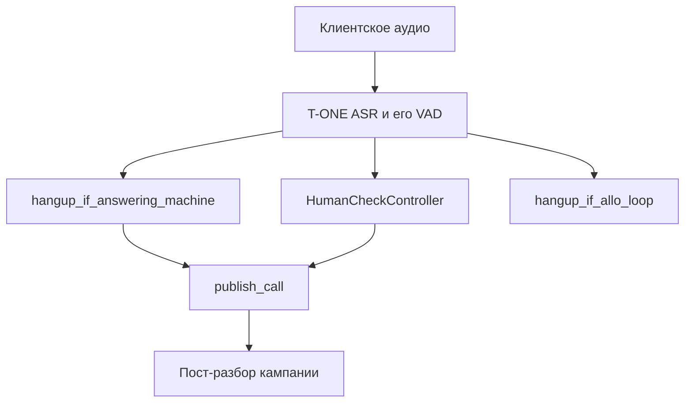
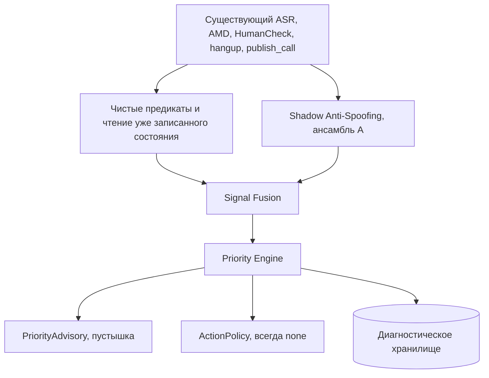

# Техническая спецификация: Unified AMD + Acoustic Anti-Spoofing

Дата: 17 ноября 2026. Это спецификация. Код, конфигурация, пороги, AMD, ASR, VAD, call flow и hangup не менялись. Inference и обучение не запускались. Новые фразы не добавлялись.

Как читать пометки:

- **Факт (код)** — поведение, которое видно в исходнике. Рядом указаны файл и функция.
- **Факт (исследование)** — уже опубликованный замер. Это не обещание времени на сервере воркера и не порог.
- **Предложение** — архитектура, которую ещё предстоит реализовать.
- **Противоречие** — предварительные правила из постановки расходятся между собой или с кодом. Здесь они названы. Приоритет в этих местах не «исправлен молча»: выбранный порядок записан явно и помечен как проектная логика shadow.
- **Неизвестно** — код или сохранённые отчёты этого не подтверждают.

Акустический контур нормативный по `reports/shadow_anti_spoofing_technical_spec.md`: состав ансамбля A, пороги, правило двух голосов, отдельный поток клиентского аудио, запрет писать в `collected_data` и в hangup. Этот документ не пересматривает пороги и не подменяет ту спецификацию. Он добавляет текстовые сигналы, fusion, приоритет и общее shadow-событие.

`amd.mode=shadow` в этой спецификации не используется как имя или механизм акустического shadow. **Факт (код).** Это режим `HumanCheckController` (`AMDConfig.mode` в `genai-agents-worker/app/config/schemas.py`).

## 1. Executive Summary

Сейчас автоответчик в звонке ищут по тексту ASR. Акустический ансамбль A (Spectra-0, SVM new, LightGBM new) в звонок не подключён. Рядом с фразовым детектором уже работают другие текстовые механизмы: триггеры HumanCheck, короткий список фраз пост-разбора кампаний и HR stall-классификатор. Это разные правила. Их нельзя слить в один список и нельзя объявить одинаково сильными.

**Предложение.** Объединённая система на первом этапе только диагностическая. Она состоит из четырёх новых логических частей, ни одна из которых не меняет текущий звонок:

1. Каталог текстовых сигналов читает уже существующие функции и фиксирует, какой сигнал совпал, при каких воротах и какой силы он уже является в текущем коде.
2. Acoustic Anti-Spoofing считает ансамбль A по клиентскому аудио так, как задано в shadow-спецификации.
3. Signal Fusion складывает снимок из трёх независимых осей: происхождение голоса, поведение, тип сценария. Оси не схлопываются в один флаг.
4. Priority Engine по этому снимку ставит `high`, `medium`, `low` или `undetermined` и пишет причину.

Shadow-событие пишется в отдельное хранилище. Оно не завершает звонок, не задаёт вопрос, не меняет ASR, VAD, `collected_data`, `publish_call` и существующий AMD.

Приоритет — проектная метка для оценки, не политика hangup. High не означает, что голос синтетический: операторская почта может быть записью живого человека. `no_decision` остаётся отсутствием акустического решения и в Low не переводится. Числовые пороги уверенности не вводятся. Score и logit не считаются вероятностями и процентами.

Вопрос клиенту на Medium и автоматическое завершение на High описаны как будущие порты. В реализацию первых четырёх этапов они не входят.

Безопаснее начинать с этапа 1: пассивная каталогизация уже существующих текстовых сигналов, флаг по умолчанию выключен, мутирующие счётчики детектора из каталога не вызываются. Акустику и приоритет к этому изменению не присоединять.

## 2. Текущая архитектура

### 2.1. Что уже участвует в звонке

**Факт (код).** Аудио абонента распознаёт T-ONE. Сборка — `build_asr_backend` в `genai-agents-worker/app/services/asr/factory.py`. Событие `user_input_transcribed` обрабатывает `register_session_input_handler` в `app/flows/call_input.py`. Сначала текст уходит в HumanCheck (`human_check.consume_final`). Если HumanCheck не блокирует деловой ход, тот же текст может уйти во фразовый детектор.

Финальность, которую видит детектор, уже искажена HumanCheck:

```47:49:genai-agents-worker/app/flows/call_input.py
        is_final = bool(getattr(event, "is_final", False)) and not consumed
        if dependencies.detect_answering_machine(
            session, stripped_text, is_final=is_final
```

**Факт (код).** Если `consume_final` вернул истину, детектор получает `is_final=False`, даже когда ASR прислал final. `HumanCheckRuntime.observe_final` в `app/flows/human_check.py` вызывает контроллер только для `event.is_final`.

**Факт (код).** Фразовый детектор подключён в `app/entrypoint.py` как `detect_answering_machine=hangup_if_answering_machine`. Он включён только когда в инструментах агента есть `end_call_answering_machine`. Флаг живых фраз приёма сообщения берётся из `amd_live_message_taker_phrases`. Значение по умолчанию у спецификации агента — `True` (`app/agents/base.py`). У агента `b2x` оно `False` (`app/agents/b2x/__init__.py`).

**Факт (код).** Отдельный `hangup_if_allo_loop` в `app/flows/allo_loop.py` завершает звонок после восьми финалов, состоящих только из «алло» и соседних слов. Источник исхода — лестница тишины, не AMD. Инструкция `JevClassifier` прямо запрещает считать ботом молчание, повторы «алло», длительность и плохой ASR (`app/human_check/classifier.py`). В каталог текстовых AMD-сигналов allo-loop не входит.



Акустического ребра на этой схеме нет. **Факт (код).** Spectra-0, SVM и LightGBM в обработчик ASR не импортируются.

### 2.2. Фразовый детектор

**Факт (код).** Решение принимает `hangup_if_answering_machine` в `app/flows/answering_machine.py`. Модели нет. Порядок ворот такой:

1. `human_check.blocks_business(session)` — выход без детекции.
2. При `amd.mode == "enforce"` дальнейшая работа только для final и только если `is_operator_voicemail_text`. Иначе выход. Поле `legacy_policy` детектор не читает. Само поле при `enforce` принудительно становится `voicemail_only` валидатором `AMDConfig._policy_for_mode`.
3. Пустой текст — выход.
4. Уже выставленный `_answering_machine_detected` — возврат `True` без нового kind и без второго hangup.
5. Для final счётчик `_answering_machine_finals_checked` увеличивается.
6. `_hangup_branch_pending` — выход. К этому моменту счётчик финалов уже увеличен.
7. Выбирается kind. Только после этого вызывается `enabled()`. Исключение `enabled()` превращается в `False`: hangup не ставится, но repeat/stall к этому моменту уже могли изменить свои множества.
8. При успехе пишется `_answering_machine_detected`, ключ `answering_machine_text` (обрезка до 200 символов), при `amd.mode != "off"` в объект `amd` кладётся `legacy` с `kind`, `verdict=legacy_answering_machine` и текстом реплики. Затем `hangup(..., source=answering_machine_detector, force=True)`.

Kind выбирается только на этом шаге и только в таком порядке:

| Условие | `kind` | Функция |
| --- | --- | --- |
| Final, и либо `finals < 3` и `is_answering_machine_text`, либо `finals < 2` и `mentions_subscriber` | `machine` | раннее машинное |
| Иначе final и `is_ai_assistant_text` | `ai_assistant` | `is_ai_assistant_text` |
| Иначе final и `_repeated_final` | `repeat` | три одинаковых финала, не короче пяти слов |
| Иначе final и `_stalling_bot` | `stalling_bot` | слабых и сильных маркеров в сумме не меньше 4 и сильных не меньше 2 |
| Interim, `finals < 3` и `is_answering_machine_text` | `machine` | interim не смотрит AI, repeat и stall |

**Факт (код).** `_repeated_final` и `_stalling_bot` увеличивают состояние сессии в момент проверки. Повторный вызов из каталога сдвинет порог настоящего детектора. `is_operator_voicemail_text`, `is_answering_machine_text`, `is_ai_assistant_text` и `mentions_subscriber` состояние сессии не меняют.

**Факт (код).** `is_operator_voicemail_text` совпадает с фразами `_OPERATOR_VOICEMAIL_PHRASES` и одновременно отвергает текст, если в нём есть слово из `_ASSISTANT_OR_SECRETARY` (`ассистент`, `помощник`, `секретарь`, `защитник`). `is_answering_machine_text` шире: к операторским фразам добавлены ещё несколько строк и, при `live_message_taker=True`, `_LIVE_MESSAGE_TAKER_PHRASES`. `is_ai_assistant_text` смотрит свой список `_AI_ASSISTANT_PHRASES` и, при том же флаге, `_LIVE_MESSAGE_TAKER_ASSISTANT_PHRASES`.

Если в одном final совпали и машинная фраза в окне первых трёх финалов, и AI-фраза, kind остаётся `machine`. Второй предикат при этом истинен, но в `legacy.kind` не попадает. Каталог обязан сохранить оба предиката.

Нормализация живого детектора — `_normalize`: нижний регистр, `ё` → `е`, знаки препинания в пробелы. Совпадение фраз — подстрока, не отдельное слово, кроме регулярных выражений абонента и stall-маркеров.

В режиме `enforce` инструмент `end_call_answering_machine` убирается из списка, который видит LLM (`app/tools/__init__.py`). Фразовый детектор при этом остаётся, но сужается до операторской почты на final.

### 2.3. HumanCheck

**Факт (код).** `AMDConfig` в `app/config/schemas.py`: режим по умолчанию `off`, иначе `shadow` или `enforce`. `human_check.install` в `app/flows/human_check.py` при `off` runtime не создаёт. В остальных режимах создаётся `HumanCheckRuntime` и `HumanCheckController`.

**Факт (код).** В `install` третьим аргументом передаётся `ctx.room.name` (`app/entrypoint.py`). Поле `HumanCheckController.call_id` поэтому является именем комнаты, а не `calls.id`. Имя комнаты в аналитическое событие не копируется. Тесты комнаты показывают, что в имени может быть телефон (`tests/test_entrypoint.py`, `tests/unit/services/test_test_calls.py` в backend). Это не идентификатор звонка для shadow.

**Факт (код).** `SuspicionTriggers.observe` в `app/human_check/triggers.py` возвращает одну из строк:

- `explicit_assistant_claim`;
- `secretary_role_claim`;
- `repeated_nonresponsive_answers`;
- `repeated_unanswered_question`.

Либо `None`. Порог повторов — `trigger_repeat_count`, по умолчанию 3, диапазон 2–10.

`explicit_assistant_claim` проходит через `_is_assistant_claim`. Там уже есть отказ на отрицание (`_NEGATED_ASSISTANT_IDENTITY`), на вопрос «вы/ты ...?» без приёма сообщения, на цитату и гипотезу, на дисклеймер «я человек» после заявки, на личное деловое «я ищу работу» и на эхо реплики агента (`_echoes_agent_identity`).

`is_automated_self_identification` уже отвергает `?`, кавычки, глаголы цитирования, гипотезу (`если`, `или`, `ли`, `якобы`), личное деловое высказывание и дисклеймер. Это более узкая проверка, чем `explicit_assistant_claim`: контроллер вызывает её ещё раз перед завершением звонка.

`secretary_role_claim` требует одновременно недоступность третьего лица и приём или передачу сообщения, без цитаты и без кавычек. Срабатывание чистится, если реплика проходит `clears_role_suspicion`.

Повторы смотрят предыдущие реплики агента и закрытые вопросы четырёх видов: `job_search`, `commitment`, `permission`, `interest`. Обычный ответ, просьба остановить звонок и защищённые формулировки («перезвоните», «я занят», жалоба на связь) доказательства стирают.

**Факт (код).** Сам триггер звонок не завершает. `HumanCheckController.observe_final` ставит состояние `assessing` и вызывает `JevClassifier`. В `shadow`, а также при вердикте вне `suspected_automated` и `automated_claim`, контроллер возвращается в `monitoring` и звонок не забирает. В `enforce` завершение `self_reported_automated` требует одновременно: вердикт `automated_claim`, триггер `explicit_assistant_claim`, попадание последней реплики в `evidence_turn_ids` и истинный `is_automated_self_identification`. Иначе при `suspected_automated` контроллер переходит к вопросам. Тексты вопросов уже заданы в `AMDConfig.question_text` и `repeat_question_text`. Менять их эта спецификация не предлагает.

`blocks_business` истинен в активных состояниях вопроса и в `finished`, а `human_check.blocks_business` добавляет ещё `recovery_failed`. Пока это так, фразовый детектор на строке 300 `answering_machine.py` не работает.

Объект `metadata` содержит вердикт, триггер, попытки, оценки и ошибки. Туда же попадают тексты вопросов и ответов. В shadow-событие тексты не копируются.

### 2.4. Пост-разбор, который не является live AMD

**Факт (код).** `ANSWERING_MACHINE_PHRASES` в `genai-agents-backend/shared/src/genai_shared/managers/call_campaigns/constants.py` — отдельный короткий кортеж. Его читает `answering_machine_phrase` в `base.py`: все не-ботовые реплики склеиваются, приводятся к нижнему регистру, ищется подстрока. Замены `ё` → `е` в этой функции нет. Отрицания, вопросы и цитаты не фильтруются.

Этот список пересекается с живым детектором частично и не является его подмножеством. В нём есть строки, которых нет в живых кортежах, включая английские `mailbox`, `voicemail`, `leave a message`, и строки вроде «автоответчик» и «виртуальный помощник». Живой `_OPERATOR_VOICEMAIL_PHRASES` содержит свои строки, которых в backend-кортеже нет. Списки не объединяются.

**Факт (код).** `hr_stalling_bot_line` в `hr/classify.py` использует те же пороги 4 и 2 и те же шаблоны маркеров, что `_stalling_bot`, но по всему транскрипту клиента после звонка и возвращает строку реплики. Живой детектор копит маркеры только по тем final, до которых дошёл его `elif`, и только пока kind не стал `machine` или `ai_assistant`. Это не один и тот же сигнал во времени.

**Факт (код).** `hr_greeting_only` относит короткий приветственный транскрипт к автоответчику только вместе с уже записанным исходом звонка. Этого правила в live-детекторе нет.

**Факт (код).** `personal4` и `b2x` повторно используют `answering_machine_phrase` и `hr_greeting_only`. Третьего списка фраз у них нет. Если в `collected_data` уже лежит непустой `answering_machine_text`, пост-разбор считает, что детектор на линии уже сработал (`detector_machine_line`, `bot_detected_machine_phrase`).

**Предложение.** Пост-разбор остаётся пост-разбором. В live Priority Engine он не подаётся. Офлайн-оценка может позже сравнить live-сигналы с этими правилами по `call_id`, не перенося их в звонок.

### 2.5. Публикация и акустика

**Факт (код).** `publish_create_call` в `app/utils/calls.py` возвращает `bool`. `flush_and_save_call_artifacts` в `app/flows/call_artifacts.py` вызывает его и не получает `calls.id` обратно. Исторический признак фразового детектора в базе — непустой `answering_machine_text`. Исторический признак HumanCheck — объект `collected_data.amd`.

**Факт (код).** `MAX_CONCURRENT_CALLS` по умолчанию 25 (`app/settings.py`). Это лимит задания воркера, не измеренная пропускная способность ансамбля A.

**Факт (код и исследование).** Правило ансамбля A, окно Spectra-0 4.0375 с, WebRTC VAD classical-моделей и отсутствие готовой шины речевых PCM на весь звонок уже зафиксированы в `shadow_anti_spoofing_technical_spec.md` и в `amd_vs_ensemble_pipeline_analysis.md`. Здесь они не переоткрываются. Для fusion достаточно контракта из раздела 4.2.

### 2.6. Что уже измерено и чего в таблицах нет

**Факт (исследование).** На 457 бинарных звонках 11–12 ноября фразовый ключ: TP 48/134, FP 0/323 `human_live`. Полный голос A: TP 109/134, FP 8/323. Детектор сработал, а A сказал human, на 11 `synthetic_tts`. Оба пропустили 14 synthetic. На 16 ноября флага детектора в таблицах нет. Голос A: TP 43/58, FP 3/303.

Первый synthetic по пути задевает 24/323 и 15/303 человеческих звонков. Полный A большинства из них возвращает в human. Стабильность «решение уже равно итогу файла и дальше не меняется» для пойманных synthetic имеет медиану около 3 окон и 17–19 с от начала записи; p90 доходит до 6–8 окон и около 50–55 с. Human, которых итог A оставляет людьми, чаще застывает на первом окне. Источники: `early_ensemble_analysis.md`, `window_stability_analysis.md`, раздел 4 и 5 `amd_vs_ensemble_pipeline_analysis.md`.

**Факт (исследование).** В бинарных когортах обоих дней нет `human_recorded`, `synthetic_voice_conversion` и `synthetic_playback`. `unknown` и `mixed` в бинарный знаменатель не входили. Вердикта HumanCheck и времени фразового срабатывания в исследовательских CSV нет.

Эти числа описывают отдельный фразовый ключ и отдельный голос A. Они не являются качеством будущего приоритета High / Medium / Low.

## 3. Каталог существующих текстовых сигналов

Новый список фраз не создаётся. Каталог — это имена уже существующих функций, kind и триггеров, плюс атрибуты, без которых теряется условие срабатывания.

Предварительные имена из постановки сопоставлены с кодом так:

| Имя из постановки | Фактическое имя сигнала | Откуда |
| --- | --- | --- |
| `operator_voicemail` | `operator_voicemail` | `is_operator_voicemail_text` |
| `machine_phrase` | `machine_phrase` | `is_answering_machine_text` истинна, `operator_voicemail` ложна |
| `weak_machine_phrase` | тот же `machine_phrase` со `strength=weak`, либо `subscriber_mention` | отдельного правила в коде нет; новое не заводится |
| `ai_assistant` | `ai_assistant` | `is_ai_assistant_text` |
| `secretary_role` | `secretary_role_claim` | `SuspicionTriggers` |
| `explicit_assistant_claim` | `explicit_assistant_claim` | `SuspicionTriggers` |
| отдельного предварительного имени нет | `automated_self_identification` | `is_automated_self_identification` |
| `repeated_response` | `repeat` | kind `_repeated_final` |
| `stalling_bot` | `stalling_bot` | kind `_stalling_bot` |
| `repeated_nonresponsive_answers` | `repeated_nonresponsive_answers` | триггер |
| `repeated_unanswered_question` | `repeated_unanswered_question` | триггер |

### 3.1. Live-сигналы, которые можно читать без изменения детектора

Сила ниже — это роль сигнала в Priority Engine, а не новая уверенность в процентах. `strong` означает «может участвовать в High по правилам раздела 6». `weak` и `suspicion` до High сами не поднимаются.

| Сигнал | Источник | Сила | Условие, которое уже есть в коде | Когда | Повтор | Контекст прошлых реплик | Причина в событии |
| --- | --- | --- | --- | --- | --- | --- | --- |
| `operator_voicemail` | `is_operator_voicemail_text` | `strong` | Подстрока `_OPERATOR_VOICEMAIL_PHRASES` после `_normalize` и отсутствие `_ASSISTANT_OR_SECRETARY` | На той реплике, где предикат истинен. Для High нужен final, который детектор реально считает final | Предикат можно пересчитать. Hangup детектора однократный | Один текст. Окно финалов на сам предикат не действует | `operator_phrase_index` — индексы совпавших строк кортежа, не текст реплики |
| `machine_phrase` | `is_answering_machine_text` без операторского предиката | `weak` | Совпала добавочная фраза `_PHRASES` или, если live-флаг истинен, `_LIVE_MESSAGE_TAKER_PHRASES` | Та же реплика. Детектор превращает её в kind `machine` только при `finals < 3` на final или interim | Предикат идемпотентен. Kind `machine` выставляется один раз | Окно `MAX_FINALS = 3` относится к kind, не к существованию предиката | `machine_phrase_index`, `live_message_taker` |
| `subscriber_mention` | `mentions_subscriber` | `weak` | Регулярное выражение слова «абонент / абонента / абоненту» | Детектор включает его в kind `machine` только на final при `finals < 2` | Предикат идемпотентен | Только счётчик финалов | `subscriber_word` |
| `ai_assistant` | `is_ai_assistant_text` | `strong` для согласования с synthetic; сам по себе High не даёт | Подстрока `_AI_ASSISTANT_PHRASES` или live-списка ассистента | Детектор ставит kind `ai_assistant` только на final и только если ранний `machine` не сработал раньше | Предикат идемпотентен | Один текст плюс флаг live | `ai_phrase_index` |
| `automated_self_identification` | `is_automated_self_identification` | `strong` | Нет `?` и кавычек, нет цитаты, гипотезы, личного делового маркера и дисклеймера, есть `_AUTOMATED_SELF_CLAIMS` | Реплика, на которой функция истинна. В enforce этого ещё недостаточно для hangup: нужен вердикт LLM | Функция идемпотентна | Один текст. Прошлый ход агента эта функция не смотрит; эхо агента отсекает только более широкий `_is_assistant_claim` | `self_identification_passed` |

**Противоречие C6.** Список `_AI_ASSISTANT_PHRASES` неоднороден: в нём есть явные представления и строки про занятость абонента и канцелярию секретаря. Код этого не делит и kind один. Спецификация список не режет и слабые строки из него в отдельный strong-тип не повышает. Пока команда не разделит кортеж отдельным решением, весь истинный `is_ai_assistant_text` остаётся одним сигналом `ai_assistant`.

### 3.2. Live-сигналы, которые нельзя пересчитывать вторым вызовом

| Сигнал | Источник | Сила | Условие | Когда | Повтор | Контекст | Причина в событии |
| --- | --- | --- | --- | --- | --- | --- | --- |
| `repeat` | Состояние после `_repeated_final`: ключ уже лежит в `_answering_machine_repeats`, длина нормализованной реплики была не меньше `REPEAT_MIN_WORDS`, счётчик достиг `REPEAT_MIN_COUNT` | `weak` | Три одинаковых final не короче пяти слов. Функция вызывается только если `machine` и `ai_assistant` на этом final не выбраны | Момент, когда детектор сам дошёл до этого `elif` | Детектор после `_answering_machine_detected` kind заново не выбирает. Каталог второй раз функцию не вызывает | Словарь прошлых нормализованных финалов. Саму строку в событие не писать | `repeat_count`, `repeat_words` — числа |
| `stalling_bot` | Множества `_answering_machine_weak_stall` и `_answering_machine_strong_stall` после того, как детектор сам вызвал `_stalling_bot` | `weak` | Уникальных маркеров суммарно ≥ 4 и сильных ≥ 2 | Тот же `elif`, после неудачного repeat | Как у `repeat` | Маркеры копятся по репликам, которые дошли до этой ветки. Реплика с kind `machine` или `ai_assistant` маркеры не пополняет | Индексы маркеров `weak_marker_indexes`, `strong_marker_indexes` |

**Предложение.** Каталог читает эти два сигнала только после возврата из `hangup_if_answering_machine`, по уже изменённым полям сессии. Вызов `_repeated_final` или `_stalling_bot` из каталога запрещён.

### 3.3. Сигналы HumanCheck

Они наблюдаются по полям, которые контроллер уже записал: `_assessment_trigger`, `metadata["trigger"]`, `metadata["suspicion_verdict"]`, `metadata["verdict"]`, `state`. `SuspicionTriggers.observe` второй раз не вызывается: метод меняет очереди реплик.

| Сигнал | Сила | Условие, уже реализованное в `triggers.py` | Контекст | Повтор |
| --- | --- | --- | --- | --- |
| `explicit_assistant_claim` | `suspicion` | `_is_assistant_claim` после фильтров отрицания, вопроса, цитаты, эха агента и личного делового текста | Текущая реплика и последняя реплика агента | Может возникнуть снова, пока не начат эпизод и не исчерпан бюджет оценок (`max_assessments` по умолчанию 2) |
| `secretary_role_claim` | `suspicion` | Недоступность третьего лица вместе с приёмом сообщения, без цитаты | До четырёх последних фрагментов роли | Сбрасывается `clears_role_suspicion` |
| `repeated_nonresponsive_answers` | `suspicion` | `trigger_repeat_count` неотвечающих обменов или приём сообщения на закрытых вопросах | История вопросов агента | Пока бюджет оценок не исчерпан |
| `repeated_unanswered_question` | `suspicion` | Столько же подряд одного и того же вида закрытого вопроса без содержательного ответа | История одного `kind` вопроса | То же |

`automated_self_identification` может быть истинен одновременно с `explicit_assistant_claim`. Это два сигнала. Более узкий не заменяет запись более широкого: иначе пропадёт факт, что контроллер пошёл в LLM по своему триггеру.

В событие не входят текст реплики, текст вопроса, `evidence` как цитата и идентификатор хода, если он построен из текста. `HumanCheckRuntime.observe_final` при отсутствии `item_id` строит id как SHA-256 от времени и транскрипта. Такой id в диагностику не пишется.

### 3.4. Что в каталог входит только как офлайн-ссылка

| Имя | Функция | Почему не live-сигнал |
| --- | --- | --- |
| `campaign_phrase` | `answering_machine_phrase` | Считается по полному транскрипту после звонка, другой список, без фильтра отрицаний и без замены `ё` |
| `hr_stall` | `hr_stalling_bot_line` | Те же маркеры, другой момент и другой корпус реплик |
| `hr_greeting_only` | `hr_greeting_only` | Зависит от уже записанного исхода звонка |

**Предложение.** Эти три имени можно стыковать с shadow-событием после появления `call_id`, в исследовательской выборке. В объект, который читает Priority Engine во время звонка, они не кладутся.

### 3.5. Совместимость со старым AMD

Старый AMD остаётся единственным механизмом, который имеет право писать `answering_machine_text` и вызывать hangup по фразе.

| Что сохраняется | Как каталог этого не ломает |
| --- | --- |
| `hangup_if_answering_machine` и порядок его ворот | Каталог не подменяет функцию. Наблюдатель либо вызывает только чистые предикаты, либо читает состояние после неё |
| Однократность hangup | Каталог не сбрасывает `_answering_machine_detected` и не вызывает hangup |
| `enforce` = только операторская почта на final | Каталог не расширяет kind, который уходит в hangup. Сигнал `ai_assistant` в `enforce` может быть виден диагностике и при этом не становиться hangup |
| Короткий `ANSWERING_MACHINE_PHRASES` | Кортеж и `answering_machine_phrase` не редактируются и не подменяются живыми списками |
| Ключ `answering_machine_text` как исторический признак детектора | Каталог этот ключ не пишет. Появление ключа по-прежнему означает, что детектор дошёл до hangup |
| Объект `collected_data.amd` | Каталог его не меняет. Снимок для события — копия нужных полей без текста |
| `amd.mode` `off` / `shadow` / `enforce` | Новых значений нет. Акустический режим называется иначе и в `AMDConfig` не хранится |
| Инструмент `end_call_answering_machine` и его снятие в `enforce` | Каталог инструмент не возвращает модели |
| Post-hoc HR и personal4 | Их правила не переносятся в воркер на этапах 1–4 |
| Allo-loop | Не становится сигналом автоматизированного собеседника |

**Предложение.** Наблюдатель текстовых сигналов подключается рядом с уже существующим вызовом, а не внутрь условия hangup. Исключение наблюдателя гасится так же, как уже гасится исключение `live_message_taker_phrases`: в журнал shadow, без изменения возвращаемого значения детектора.

Если HumanCheck уже вернул `blocks_business`, детектор до предикатов не доходит. Чистые предикаты каталог всё равно может посчитать по тому же `stripped_text`, потому что они не меняют сессию. В событии тогда будут и сигнал, и ворота `blocked_by_human_check`. Это не включает hangup. Приоритет такого сигнала разобран как противоречие C7.

### 3.6. Поля одного текстового сигнала

**Предложение.**

| Поле | Смысл |
| --- | --- |
| `signal_id` | Монотонный номер внутри `shadow_session_id` |
| `type` | Имя из таблиц 3.1–3.3 |
| `source` | `answering_machine_detector` или `human_check` |
| `strength` | `strong`, `weak` или `suspicion` |
| `is_final` | Какой final видел детектор, с учётом `consume_final` |
| `finals_checked` | Значение счётчика на этой реплике, если оно уже есть |
| `live_message_taker` | Фактический флаг агента; при исключении колбэка детектор оставляет `True`, каталог записывает то же |
| `gates` | `blocked_by_human_check`, `enforce_filtered`, `already_detected`, `hangup_branch_pending`, `tool_disabled`, `none` |
| `hangup_eligible` | Истина только если детектор на этой реплике дошёл бы до своего hangup. Каталог это поле вычисляет по тем же воротам, hangup не вызывает |
| `detector_kind` | `machine`, `ai_assistant`, `repeat`, `stalling_bot` или null. Это kind детектора, он может быть у́же набора предикатов |
| `reason_code` | Код из таблиц выше |
| `elapsed_s` | Секунды от старта наблюдения звонка, монотонные часы воркера |
| `emitted_at` | ISO-8601 |

Полный текст реплики, нормализованная строка и совпавшая подстрока как фрагмент речи клиента в структуру не входят. Индекс строки в уже существующем кортеже достаточен, чтобы восстановить правило.

## 4. Целевая архитектура

**Предложение.** Четыре компонента и два будущих порта. Порты на этапах 1–4 имеют реализацию-пустышку.



Граница:

- ASR-обработчик не делает `await` на акустику, fusion и запись события. Он может синхронно посчитать чистые предикаты и положить коды в очередь. Очередь при переполнении сбрасывает снимок и ставит `dropped_signal`, звонок не ждёт.
- Акустическая задача не вызывает `hangup_if_answering_machine`, `HumanCheckController` и `publish_create_call`.
- Fusion не переписывает исходные сигналы и не заменяет решение A.
- `PriorityAdvisory.publish` на этапах 1–4 возвращается сразу. `HumanCheckController` на неё не подписан.
- `ActionPolicy.decide` возвращает `none`. До `play_farewell_and_hangup_session` эта политика не доходит.

Имя акустического флага не равно `amd.mode`. **Предложение.** Отдельные флаги, каждый по умолчанию выключен: каталог текста, акустический shadow, fusion. Выключение флага не требует отката данных звонка, потому что звонок эти компоненты не читают.

### 4.1. Text AMD как логический слой

**Предложение.** Модуль наблюдения в воркере, рабочее имя `app/diagnostics/text_signals.py`. Он не владеет списками фраз. Он вызывает публичные чистые функции `answering_machine.py` и `triggers.py` и читает:

- `_answering_machine_detected`, `_answering_machine_finals_checked`, множества stall и счётчик repeat — только на чтение и только после детектора;
- `HumanCheckController.state`, `metadata["trigger"]`, `metadata["suspicion_verdict"]`, `metadata["verdict"]`, `metadata["mode"]`, `blocks_business`.

При `amd.mode=off` runtime HumanCheck отсутствует. Снимок тогда: `human_check_mode=off`, триггеры пустые, `snapshot_status=ok`. Ошибка чтения даёт `snapshot_status=unavailable` и пустое состояние, не ошибку звонка.

### 4.2. Acoustic Anti-Spoofing

**Предложение.** Компонент берётся из shadow-спецификации без изменения состава и порогов.

Состав: Spectra-0, SVM new, LightGBM new.

Пороги, уже зафиксированные и здесь не пересматриваемые:

- Spectra-0 synthetic, если средний margin строго меньше `0.22710928916931153`;
- SVM synthetic, если `decision_function` не ниже `0.0`;
- LightGBM synthetic, если выход `predict_proba` класса synthetic не ниже `0.3460832258410117`.

`predict_proba` в событии остаётся score модели. В вероятность для продукта и в процент уверенности он не превращается. Margin Spectra-0 тоже не процент.

Правило голоса:

1. Валидных оценок меньше двух → `ensemble_decision=no_decision`.
2. Валидных не меньше двух и synthetic среди них не меньше двух → `synthetic`.
3. Валидных не меньше двух и synthetic среди них меньше двух → `human`.

Следствия, которые fusion не имеет права упростить:

- один synthetic и два пустых результата → `no_decision`;
- synthetic и human при третьей пустой модели → валидных два, synthetic один → `human`;
- ошибка или timeout очищает только score этой модели;
- отсутствие аудио не создаёт `human`.

Модуль анализирует аудио клиента: свой `AudioStream` SIP-участника, 8000 Гц, 1 канал, свой WebRTC VAD. Правило столбца `excel-` на живой трек не переносится. ASR, AMD и VAD T-ONE этот поток не ждут. Точка врезки и открытые вопросы второго читателя трека остаются такими, как в разделах 4 и 13 shadow-спецификации. Пока эксперимент двух `AudioStream` не сделан, этап 2 в production не включается.

### 4.3. Signal Fusion

**Предложение.** Fusion получает уже готовые объекты: список текстовых сигналов, снимок HumanCheck, последний `AcousticUpdate`, счётчики стабильности. Он строит `SignalSnapshot` и исходные объекты не меняет.

Три оси хранятся рядом с приоритетом и приоритетом не затираются.

**Происхождение голоса, `voice_origin`:**

| `ensemble_decision` | `voice_origin` |
| --- | --- |
| `synthetic` | `synthetic` |
| `human` | `human` |
| `no_decision` или акустики ещё не было | `unknown` |

**Поведение, `behavior`.** Это не результат OR всех текстов.

| Условие | `behavior` |
| --- | --- |
| Есть `operator_voicemail`, или `automated_self_identification`, или `ai_assistant`, или `machine_phrase` | `automated` |
| Иначе есть `subscriber_mention`, `repeat`, `stalling_bot` или любой suspicion-триггер HumanCheck | `suspicious` |
| Иначе был хотя бы один final клиента и ни одного сигнала | `normal` |
| Иначе | `unknown` |

`machine_phrase` попадает в `automated`, потому что живой детектор уже считает эти фразы машинными в окне первых финалов. В High эта же фраза не поднимается: сила у неё `weak`. Ось поведения и приоритет поэтому расходятся намеренно. Запись живого человека в операторской почте даёт `behavior=automated` и может дать `voice_origin=human`.

Если на снимке есть и automated-сигнал, и suspicion-сигнал, поведение `automated`, а suspicion остаётся в списке сигналов.

**Тип сценария, `scenario_types`.** Список, не один перезаписанный ярлык.

| Сигнал | Метка сценария |
| --- | --- |
| `operator_voicemail` | `voicemail_ivr` |
| `automated_self_identification` или `explicit_assistant_claim` | `ai_assistant` |
| `ai_assistant` | `ai_assistant` |
| `machine_phrase` при включённом live-приёме сообщения | `message_taker` |
| `secretary_role_claim` | `secretary` |
| `repeat`, `stalling_bot`, `repeated_nonresponsive_answers`, `repeated_unanswered_question` | `behavioral` |

Пустой список означает `unknown` и в поле `scenario_types` записывается пустым, отдельной строкой «другое» не маскируется. Несколько меток сохраняются все. Порядок меток фиксирован таблицей сверху, чтобы снимок не прыгал от порядка вычисления.

Fusion не реализует сценарии «ИЛИ» и «И» из раздела 6 прежнего аудита. Те сценарии измеряли фразовый ключ против голоса A как один бинарный класс. Здесь у голоса, поведения и сценария разные вопросы.

### 4.4. Priority Engine

**Предложение.** Отдельная чистая функция `priority_of(snapshot) -> PriorityDecision`. Она не читает аудио, не ходит в LLM и не пишет в сессию. Вход — только `SignalSnapshot`. Выход:

- `priority`: `high`, `medium`, `low`, `undetermined`;
- `reason_codes`: все сработавшие причины, не одна;
- `primary_reason`: первая причина по порядку раздела 6;
- `rule_version`: `unified-priority-v1`;
- `conflicts`: идентификаторы противоречий, если на этот снимок попало больше одного пункта раздела 7.

Приоритет не записывается обратно в `voice_origin`, `behavior` и `scenario_types`.

### 4.5. Будущий вопрос на Medium

Сейчас вопрос клиенту не включается. `HumanCheckController` акустику не получает, `amd.mode` не меняется, тексты `question_text` не меняются, `enforce` не меняется, `blocks_business` от приоритета не зависит.

**Предложение.** Порт, который Priority Engine уже может звать:

```text
PriorityAdvice
  shadow_session_id
  priority
  additional_check          # на этапах 1–4 всегда false
  termination_candidate     # на этапах 1–6 всегда false
  reason_codes
  rule_version

PriorityAdvisory.publish(advice) -> None
```

Реализация этапов 1–4 — `NoOpPriorityAdvisory`. Контроллер в конструктор порта не передаётся. Акустические score в `PriorityAdvice` отсутствуют, поэтому будущий подписчик не сможет случайно прочитать их из совета.

Будущее подключение, отдельным согласованным изменением, выглядит так и не требует переписывать разбор триггеров:

1. Появляется второй адаптер `HumanCheckAdvisoryAdapter`. Он подписывается на порт снаружи контроллера.
2. Адаптер реагирует только на `additional_check=true`. Это поле выставляется только при `priority=medium` и только после отдельного разрешения.
3. Адаптер вызывает новый метод `HumanCheckController.note_external_check_requested(reason_codes)`. На этапах 1–4 метода нет, либо он сразу возвращается. Метод не принимает score, logits и `ensemble_decision`.
4. Когда метод разрешат реализовать, он может переиспользовать уже существующий путь вопроса: состояния `takeover_pending` и `_run_challenge`, тексты из `AMDConfig`. Условие входа в этот путь останется прежним, пока отдельное решение не скажет иначе: сейчас вопрос задаёт только `enforce` после вердикта подозрения. Новый метод не должен обходить это условие сам по себе.
5. Существующий `observe_final` и `SuspicionTriggers` не начинают читать приоритет. Источник просьбы о проверке хранится в metadata как код причины, без текста реплики и без акустики.

Так HumanCheck остаётся владельцем своих состояний. Priority Engine остаётся владельцем совета. Связка между ними — один метод, который сегодня ничего не делает.

`additional_check` не ставится для High, Low и Undetermined. High — кандидат будущего завершения, а не дополнительного вопроса. Undetermined означает, что данных мало, а не что пора спрашивать.

### 4.6. Будущий Action Policy

**Предложение.** Компонент `ActionPolicy` получает тот же снимок и возвращает действие. Единственное действие этой спецификации — `none`.

Класс не импортирует `play_farewell_and_hangup_session`. Регистрации в `entrypoint` у него нет. Поле `termination_candidate` в совете остаётся `false`, чтобы даже ошибочно подключённый исполнитель не увидел разрешения.

Будущее автоматическое завершение потребует отдельного согласования и отдельного исполнителя. Исполнитель можно будет повесить на тот же `PriorityAdvisory`, не меняя Priority Engine, если когда-нибудь `termination_candidate` станет истинным. До этого момента исполнитель не создаётся.

Условия, без которых `termination_candidate` не получает права стать истинным, даже в будущей спецификации:

- раннее synthetic-решение меняется: на 11–12 первый synthetic задевает 24 из 323 `human_live`, полный A оставляет ложными 8 из 323; на 16 ноября это 15 из 303 и 3 из 303;
- первое synthetic-решение основанием hangup не является;
- момент, когда решение перестало меняться до конца файла, известен только задним числом. Он не равен измеренной точности и в онлайн-правило здесь не переводится;
- допустимый FPR на `human_live` не согласован;
- допустимое время решения не согласовано;
- `voice_origin=unknown`, включая `no_decision` и отсутствие аудио, не означает человека и не означает автоответчик;
- High из-за операторской почты не доказывает синтетическое происхождение. Будущий hangup по такой почте, если его согласуют, будет решением о сценарии, а не о синтетике. Текущий фразовый hangup при этом и так уже существует и этой политикой не заменяется и не отключается.

Число подтверждений подряд и секунда отсечки здесь не назначаются. Подбирать их по 11–12 и 16 ноября нельзя: эти дни уже использованы для описания A.

## 5. Правила Signal Fusion

**Предложение.** На каждый вход fusion пересчитывает снимок целиком из текущих сигналов. Старый приоритет не «дотягивается» до нового события, если сигналы изменились.

Вход считается изменившимся, если изменилось хотя бы одно из:

- множество текстовых сигналов и их `gates`;
- `human_check.state`, `trigger`, `suspicion_verdict`, `verdict`, `blocks_business`;
- `ensemble_decision`, `valid_vote_count`, `no_decision_reason` или score любой из трёх моделей;
- факт `dropped_audio` или ошибки модели.

Пересчёт, который дал те же оси, тот же приоритет и те же `reason_codes`, новой строкой не пишется. Это защищает от того, что HumanCheck и так переписывает объект `amd` на оценках: акустика и приоритет при этом могут стоять.

Оси считаются по таблицам раздела 4.3. Дополнительные правила:

- Сигнал с `gates=blocked_by_human_check` в списке сигналов остаётся. В ось поведения он входит. В `hangup_eligible` он не входит.
- `detector_kind=machine` сам по себе strong не является. Strong для операторской почты ставится только сигналом `operator_voicemail`.
- `no_decision` не подставляется в ось как `human` и не подставляется как `synthetic`.
- Post-hoc `campaign_phrase`, `hr_stall` и `hr_greeting_only` в снимок звонка не входят.
- Allo-loop в снимок не входит.
- Несколько сигналов одного типа не схлопываются: хранится первый и последний `elapsed_s` и счётчик. Текст по-прежнему не хранится.

Стабильность акустики в снимке — описание истории, не порог:

| Поле | Смысл |
| --- | --- |
| `decision_changes` | Сколько раз `ensemble_decision` переходило между `synthetic` и `human`. Переходы через `no_decision` считаются отдельно в `no_decision_gaps` |
| `updates_with_two_votes` | Сколько акустических обновлений имели не меньше двух валидных голосов |
| `updates_since_last_change` | Сколько таких обновлений прошло после последнего перехода synthetic/human |
| `first_decision_elapsed_s` | Первое обновление с двумя голосами |
| `first_synthetic_elapsed_s` | Первое synthetic, если оно было |
| `current_decision_since_elapsed_s` | Когда текущее synthetic или human установилось |

Поля не сравниваются с числом «достаточно окон». Исследование показало, что такое число по пойманным synthetic и по живым людям разное, и эта спецификация его не выбирает.

## 6. Правила Priority Engine

Проектная логика shadow. Версия `unified-priority-v1`. Если совпали несколько пунктов, в `reason_codes` остаются все, `primary_reason` берётся из самого верхнего совпавшего пункта. Пункты специально поставлены так, чтобы конкретные строки таблицы раздела 8 перебивали общие формулировки Medium. Это и есть объявленная обработка противоречий, а не тихая правка.

High:

1. `operator_voicemail` на реплике, которую детектор считает final. Акустика может быть `synthetic`, `human` или `unknown`. Причина `operator_voicemail`.
2. `automated_self_identification`. Акустика любая. Причина `automated_self_identification`. Вердикт LLM записывается рядом и этот пункт не отменяет. См. C3.
3. `ai_assistant` и `voice_origin=synthetic`. Причина `acoustic_synthetic_and_ai_assistant`.

Medium, если High не сработал:

4. `ai_assistant` есть, а `voice_origin` равен `human` или `unknown`. Причина `strong_text_without_acoustic_agreement`.
5. `voice_origin=synthetic`, а `operator_voicemail`, `automated_self_identification` и `ai_assistant` отсутствуют. Слабый текст и suspicion приоритет не повышают. Причина `acoustic_synthetic_without_strong_text`.
6. Есть suspicion-триггер, и пункт 2 не сработал. Акустика любая, включая `human` и `unknown`. Причина `human_check_suspicion`.
7. Есть слабый сигнал: `machine_phrase`, `subscriber_mention`, `repeat` или `stalling_bot`. Акустика любая. Причина `weak_text`.

Low:

8. `voice_origin=human`, нет strong, нет weak, нет suspicion. Причина `acoustic_human_no_suspicion`.

Undetermined:

9. Всё остальное. В том числе `voice_origin=unknown` без strong, weak и suspicion. Причина `insufficient_information`. Отсутствие события акустики и `no_decision` оба попадают сюда, если текстовых оснований нет.

`primary_reason` при нескольких Medium-причинах идёт в порядке пунктов 4, 5, 6, 7.

Interim-совпадение `operator_voicemail` записывается сигналом с `is_final=false` и пункт 1 не включает. Так повторяется ворота `enforce`, где операторская почта завершает звонок только на final. В таблице раздела 8 строка «операторская почта» означает этот final-сигнал.

`ai_assistant` на interim детектор kind не ставит: interim умеет стать только `machine` через `is_answering_machine_text`. Пункт 3 требует сигнал `ai_assistant`, то есть истинный предикат. Если команда захочет дополнительно требовать `detector_kind=ai_assistant`, это уже сужение относительно предиката и должно сменить `rule_version`. В v1 пункт 3 смотрит предикат и `voice_origin`, а `detector_kind` остаётся в снимке для разбора.

## 7. Таблица сценариев

Строки постановки. «Нет» в HumanCheck означает: suspicion-триггера нет и `automated_self_identification` ложна. «Операторская почта» означает final-сигнал `operator_voicemail`. «AI Assistant» означает сигнал `ai_assistant` без операторской почты и без `automated_self_identification`. «Слабый текст» означает weak-сигнал без strong. «Нет сильного текста» на строке synthetic означает отсутствие strong; слабого на этой строке тоже нет, иначе это следующая строка.

| Text AMD | HumanCheck | Acoustic A | Priority | Причина |
| --- | --- | --- | --- | --- |
| Операторская почта, final | Нет | Synthetic | High | `operator_voicemail`. Сильный текст. Голос при этом тоже synthetic, но High держится на тексте |
| Операторская почта, final | Нет | Human | High | `operator_voicemail`. Поведение почты подтверждено, `voice_origin` остаётся `human` |
| Операторская почта, final | Нет | No decision | High | `operator_voicemail`. Текст не ждёт акустику. `voice_origin=unknown` |
| AI Assistant | Нет | Synthetic | High | `acoustic_synthetic_and_ai_assistant` |
| AI Assistant | Нет | Human | Medium | `strong_text_without_acoustic_agreement` |
| AI Assistant | Нет | No decision | Medium | `strong_text_without_acoustic_agreement` |
| Нет сильного текста | Нет | Synthetic | Medium | `acoustic_synthetic_without_strong_text` |
| Слабый текст | Нет | Synthetic | Medium | `weak_text`. Слабый сигнал High не включает. Synthetic сам по себе тоже остаётся Medium |
| Нет текста | Suspicion trigger | Human | Medium | `human_check_suspicion` |
| Нет текста | Нет | Human | Low | `acoustic_human_no_suspicion` |
| Нет текста | Нет | No decision | Undetermined | `insufficient_information` |

Дополнительные комбинации. Они следуют из тех же пунктов, в постановке отдельной строкой не были.

| Комбинация | Дополнительное условие | Priority | Причина |
| --- | --- | --- | --- |
| `automated_self_identification`, акустика любая | Функция `is_automated_self_identification` истинна. Вердикт LLM может отсутствовать, потому что в `shadow` и `off` контроллер до hangup по самоидентификации не доходит | High | `automated_self_identification` |
| Тот же сигнал, и LLM уже записал `no_suspicion` или `human_claim` | Условие C3. Приоритет v1 остаётся High, в `conflicts` пишется `C3` | High | тот же код, плюс конфликт |
| Операторская почта только на interim | `is_final=false` после правила `call_input` | Не High. Дальше обычные пункты 4–9 | Сигнал хранится, пункт 1 молчит |
| Операторская почта, пока `blocks_business` | Предикат истинен, детектор hangup не делал | High по пункту 1, `hangup_eligible=false`, конфликт `C7` | Текст и текущий hangup расходятся намеренно |
| Suspicion и synthetic, сильного текста нет | В основной таблице есть только suspicion + human | Medium | `human_check_suspicion` и `acoustic_synthetic_without_strong_text` |
| Suspicion и `no_decision`, сильного текста нет | То же | Medium | `human_check_suspicion`. Это не Undetermined: триггер уже есть |
| Слабый текст и human | В основной таблице слабый текст показан только с synthetic | Medium | `weak_text`. Low требует отсутствия слабых сигналов |
| Слабый текст и `no_decision` | То же | Medium | `weak_text` |
| `repeat` или `stalling_bot` при любой акустике | Нет strong и нет более ранней Medium-причины, которая стала primary | Medium | `weak_text` |
| AI Assistant и suspicion и human | Два Medium-основания, High нет, потому что голос не synthetic | Medium | primary `strong_text_without_acoustic_agreement`, второй код тоже в списке |
| Операторская почта и suspicion | Пункт 1 выше пункта 6 | High | `operator_voicemail`; suspicion остаётся в сигналах и в `reason_codes` не подменяет primary |
| Нет текста, HumanCheck `off`, акустики нет | Режим `off` не создаёт runtime | Undetermined | `insufficient_information` |
| Нет текста, нет suspicion, акустика `human` | Основная строка Low | Low | `acoustic_human_no_suspicion` |

`mixed` и `unknown` в эту таблицу не входят: это метки разметки, не вход движка.

## 8. JSON-схема shadow-событий

**Предложение.** Одно аналитическое событие объединяет акустику, текст, HumanCheck и приоритет. Внутренний `AcousticUpdate` может жить в памяти акустической задачи в форме схемы из shadow-спецификации. Наружу, в исследовательское хранилище, пишется только событие этого раздела. Два параллельных исследовательских журнала не ведутся.

Идентификатор звонка в событии — только `call_id`, и только если это уже `calls.id`. До публикации звонка поле null. Ключ процесса — `shadow_session_id`, новый UUID на задачу shadow. Имя комнаты, `HumanCheckController.call_id`, `external_id`, `request_id` в это событие не кладутся. Связка UUID с `calls.id` остаётся операционной и в выгрузку исследования попадает уже как `call_id`. Телефон в операционной связке не хранится.

Запрещённые поля, даже пустой строкой: `phone`, `phone_number`, `external_id`, `s3_key`, `s3_bucket`, `msisdn`, имя комнаты, текст реплики, нормализованный текст, цитата `legacy.text`, вопросы и ответы HumanCheck.

### 8.1. Событие

| Поле | Тип | Null | Значения |
| --- | --- | --- | --- |
| `schema_version` | int | нет | `1` для этого объединённого события |
| `shadow_session_id` | UUID string | нет | ключ задачи |
| `call_id` | UUID string | да | `calls.id`, иначе null |
| `event_timestamp` | string | нет | ISO-8601 со зоной |
| `elapsed_s` | number | нет | секунды от старта наблюдения |
| `recording_elapsed_s` | number | да | секунды клиентского аудио; null, если кадров ещё не было |
| `speech_elapsed_s` | number | да | сумма закрытых речевых сегментов shadow VAD |
| `update_kind` | string | нет | `text_signal`, `human_check`, `spectra_window`, `classical_segment`, `fusion`, `call_end` |
| `update_seq` | int | нет | монотонный номер события внутри сессии |
| `text_signals` | array | нет | элементы ниже; пустой массив, если сигналов нет |
| `human_check` | object | нет | снимок ниже |
| `acoustic` | object | нет | снимок ниже |
| `fusion` | object | нет | три оси и стабильность |
| `priority` | string | нет | `high`, `medium`, `low`, `undetermined` |
| `primary_reason` | string | нет | код раздела 6 |
| `reason_codes` | array of string | нет | все совпавшие коды |
| `conflicts` | array of string | нет | `C1`…`C8` или пусто |
| `rule_version` | string | нет | `unified-priority-v1` |
| `text_rules_version` | string | нет | версия сборки воркера и имена функций, не копирующая фразы |
| `model_version` | string | нет | три файла весов, как в shadow-спецификации |
| `threshold_version` | string | нет | три константы раздела 4.2 |
| `processing_delay_ms` | number | да | от момента входа в очередь до записи события |
| `dropped_audio` | bool | нет | очередь аудио сбрасывала кадры |
| `dropped_signal` | bool | нет | очередь текстовых снимков сбрасывала обновление |
| `errors` | array | нет | объекты `{component, code}` без текста реплики и без пути к файлу записи |

`text_signals[]`: `signal_id`, `type`, `source`, `strength`, `is_final`, `finals_checked`, `live_message_taker`, `gates`, `hangup_eligible`, `detector_kind`, `reason_code`, `pattern_indexes`, `elapsed_s`. `pattern_indexes` — индексы в существующем кортеже. Для repeat здесь числа `repeat_count` и `repeat_words`. Для stall — индексы маркеров.

`human_check`:

| Поле | Значения |
| --- | --- |
| `mode` | `off`, `shadow`, `enforce`; null только при `snapshot_status=unavailable` |
| `state` | состояние контроллера или null |
| `blocks_business` | bool или null |
| `trigger` | четыре строки триггера или null |
| `suspicion_verdict` | `suspected_automated`, `insufficient_evidence`, `no_suspicion` или null |
| `verdict` | вердикт, который контроллер уже записал, или null |
| `attempts` | int или null |
| `snapshot_status` | `ok` или `unavailable` |

`acoustic`:

| Поле | Значения |
| --- | --- |
| `spectra0_score`, `spectra0_decision` | число или null; `synthetic`, `human` или null |
| `svm_score`, `svm_decision` | то же. Score — `decision_function` |
| `lightgbm_score`, `lightgbm_decision` | то же. Score — выход модели, не процент |
| `ensemble_decision` | `synthetic`, `human`, `no_decision` |
| `no_decision_reason` | `no_client_audio`, `insufficient_audio`, `insufficient_models`, `timeout`, `model_error` или null |
| `valid_vote_count` | 0, 1, 2 или 3 |
| `padded_tail` | bool или null |
| `update_end_ms` | конец окна или сегмента; для неакустического события — последний известный конец или null |

Причины `no_decision` те же, что в shadow-спецификации. У решения `human` и `synthetic` поле `no_decision_reason` равно null, `valid_vote_count` не меньше 2.

`fusion`: `voice_origin`, `behavior`, `scenario_types`, `decision_changes`, `no_decision_gaps`, `updates_with_two_votes`, `updates_since_last_change`, `first_decision_elapsed_s`, `first_synthetic_elapsed_s`, `current_decision_since_elapsed_s`.

`errors[].component`: `audio`, `vad`, `spectra0`, `svm`, `lightgbm`, `text`, `human_check_snapshot`, `fusion`, `store`. `errors[].code`: `timeout`, `model_error`, `unavailable`, `dropped`, `write_failed`.

### 8.2. Когда писать

- Закрылось окно Spectra-0 или пригодный classical-сегмент: акустика пересчитана, fusion и приоритет пересчитаны вместе с ней.
- Появился новый текстовый сигнал, изменились ворота или изменился снимок HumanCheck, и из-за этого изменились оси, приоритет или `reason_codes`.
- Звонок закончился: одно `call_end` с последним снимком. Если кадров не было, акустика — `no_decision` / `no_client_audio`. Если к этому моменту не было и текста, приоритет `undetermined`.

Кадр RTP событием не является. Каждая перезапись metadata HumanCheck событием не является, пока снимок для fusion не изменился.

### 8.3. Дедупликация и состояние звонка

**Предложение.** Две записи.

Журнал событий дописывается. Ключ идемпотентности: `shadow_session_id` + `update_kind` + `update_seq`. `update_seq` назначает процесс до отправки. Повтор того же ключа вторую строку не создаёт. Если повтор несёт другие priority или score, сохраняется первая успешная строка, в метрику пишется конфликт дедупликации, без аудио и без телефона.

Почему одного `call_id` недостаточно: во время звонка его ещё нет; окно Spectra-0 и classical-сегмент могут кончиться в одну миллисекунду; текстовый сигнал может прийти в ту же миллисекунду, что и окно. `update_kind` эти случаи разделяет, `update_seq` разделяет два текстовых сигнала одного kind.

Состояние звонка — одна текущая строка на `shadow_session_id`. В неё попадает последний успешно записанный снимок: приоритет, оси, акустика, сигналы, `call_id`. Журнал при этом не переписывается. Исследование стабильности читает журнал. Сводка «какой приоритет был в конце» читает состояние.

Когда операционная связка получает `calls.id`, null в журнале и в состоянии этой сессии заполняется этим id. Строки другой сессии не трогаются. Повторная обработка того же разговора после падения процесса создаёт новый `shadow_session_id`. Склеивать сессии по имени комнаты нельзя.

События без `call_id` в исследовательский отчёт по разметке не выгружаются. Они остаются в операционном хранилище до связки и учитываются в метрике несвязанных сессий.

Потеря записи после исчерпания повторов увеличивает метрику потерь и звонок не останавливает. `publish_call` эту запись не повторяет: у него другое соединение и другая схема.

## 9. Требования к производительности

Бюджет миллисекунд эта спецификация не назначает. Ограничение другое: путь ASR не ждёт акустику и запись.

**Факт (код).** Заказанная конкуренция воркера — `MAX_CONCURRENT_CALLS = 25`.

**Факт (исследование).** На машине отчётов `cpu_inference_analysis.md` и `cpu_gpu_inference_200.md` медиана одного окна Spectra-0 на CPU в один поток была около 1.4 с при длине окна 4.0375 с. На четырёх потоках PyTorch одного процесса медиана падала примерно до 0.6–0.8 с. На GPU той же машины медиана окна была около 27 мс. Признаки одного закрытого сегмента: медиана около 157 мс. Вызов SVM и LightGBM по готовой строке — около 1 мс. Это не сервер воркера и не нагрузка 25 звонков.

**Предложение.**

- Текстовые чистые предикаты выполняются в обработчике только как синхронные функции, которые детектор и так умеет считать, и сразу кладут коды в ограниченную очередь. В обработчике нет inference, HTTP HumanCheck, записи в хранилище и ожидания акустической задачи.
- У акустики своя очередь inference с верхней границей. Общий пул на процесс, а не четыре потока PyTorch на каждый из 25 звонков. Один экземпляр Spectra-0 и одни classical-bundle на процесс.
- При переполнении очереди аудио кадры открытого сегмента сбрасываются, `dropped_audio=true`, дырявый сегмент не даёт classical-голос. При переполнении очереди снимков новый снимок заменяет непрочитанный, `dropped_signal=true`.
- Fusion считает приоритет на задаче shadow, вне обработчика ASR.
- Запись событий не использует соединение `publish_call`.
- Сырой звук всего звонка в памяти не держится. Буфер — открытый сегмент и уже посчитанные агрегаты, как в shadow-спецификации.

**Неизвестно и требует прототипа или нагрузочного теста, не этой спецификации:**

- мешает ли второй `AudioStream` потоку T-ONE;
- есть ли у процесса воркера GPU и какой у него запас CPU при 25 звонках вместе с ASR;
- выстраиваются ли 25 окон в одну секунду и какая тогда глубина очереди, число timeout и число сброшенных сегментов;
- RSS с загруженными моделями и 25 буферами открытого сегмента;
- задержка T-ONE и время до `publish_call` с выключенными и включёнными флагами на одних и тех же тестовых звонках;
- добавляет ли чтение снимка HumanCheck заметное время, если делать его в обработчике, а не в задаче shadow. Пока это неизвестно, чтение снимка тоже стоит в задаче shadow, а обработчик только ставит факт «реплика пришла» без текста.

До этих замеров утверждение «25 звонков успевают» в спецификацию не входит.

## 10. Отказоустойчивость

**Предложение.** Главный цикл звонка нигде не ждёт задачу каталога, акустики и fusion. Отмена звонка отменяет эти задачи. `publish_call` их не ждёт. Исключение внутри задачи пишется в `errors` события, если запись ещё возможна, и наружу звонка не выходит. Образец изоляции уже есть у `_create_task_logged` в `app/runtime.py`: исключение задачи логируется и звонок само по себе не отменяет. Новые задачи повторяют эту изоляцию и не берут `_infer_lock` ASR.

| Ситуация | Поведение диагностики | Звонок |
| --- | --- | --- |
| Флаг компонента выключен | Задача не создаётся | Как сейчас |
| Ошибка загрузки модели | Акустика заканчивается, событие с `model_error` и `no_decision`, если голосов меньше двух | Boot и AMD идут своим путём |
| Timeout одной модели | Её score null. Если валидных голосов меньше двух, причина `timeout`. Следующее окно не ждёт зависший расчёт | Не ждёт |
| Исключение одной модели | То же с `model_error` | Процесс воркера исключением задачи не роняется |
| Нет клиентского аудио к концу звонка | `call_end`, `no_client_audio`, приоритет по тексту, а если текста нет — `undetermined` | Завершается своей логикой |
| Дырявое аудио | `dropped_audio`, classical-голос этого сегмента не ставится | ASR читает свой поток |
| Снимок HumanCheck не прочитался | `snapshot_status=unavailable`. Приоритет считается по тем сигналам, которые уже есть, конфликт не выдумывается | Не ждёт |
| Исключение чистого предиката | Этот сигнал пропускается, `errors` получает `text/unavailable`. Детектор свой результат не меняет | Hangup детектора, если он уже решил стрелять, сохраняется |
| Ошибка записи | Ограниченные повторы внутри shadow. Затем потеря и метрика | `publish_call` не повторяет событие |
| Звонок закончился до `call_id` | События остаются на `shadow_session_id`, `call_id=null` | Публикация, успешная или нет, от shadow не зависит |
| Падение процесса | Уже принятые хранилищем строки остаются. Память задачи пропадает | Как при любом падении воркера |
| Закрытие звонка | `call_end` ставится в очередь, незаконченный inference помечается timeout или отменяется, буфер сбрасывается, задача не остаётся ждать модели дольше собственного shutdown воркера | `HumanCheckController.close` и публикация живут как сейчас |
| Повторная обработка | Новый `shadow_session_id`, старые строки не переписываются | Звонок из-за shadow заново не стартует |

`no_decision` после любой из этих ошибок не заменяется на `human`. Приоритет Low из ошибки акустики не строится.

## 11. План тестирования и оценки качества

Проверки этого раздела спецификация не запускает.

### 11.1. Уже известная база, которую не надо пересчитывать

Её можно цитировать как описание отдельных систем, не как качество приоритета:

- фразовый ключ против A на 457 звонках 11–12 ноября;
- полный A на 457 и на 361 звонке 16 ноября;
- ранний synthetic и откат, `early_ensemble_analysis.md`;
- совпадение с итогом по окнам, `window_stability_analysis.md`;
- локальные времена CPU и GPU на исследовательской машине.

Новый inference, переобучение и подбор порога на этих днях не входят в план. Секунду hangup по ним не выбирать.

### 11.2. Тесты реализации, без боевого трафика

1. Чистые предикаты на фиксированных строках из уже существующих тестов `tests/test_answering_machine.py`: операторская почта, отказ при слове «секретарь» или «ассистент», AI-фраза, слово «абонент», live-флаг `b2x`. Ожидание совпадает с текущими функциями.
2. Повторный вызов каталога не меняет `_answering_machine_repeats` и множества stall. Это проверяется счётчиком до и после.
3. В `enforce` детектор по-прежнему не ставит hangup на AI-фразу и ставит его на final операторской почты. Каталог при этом может видеть оба предиката.
4. `blocks_business` по-прежнему не даёт детектору дойти до hangup.
5. `is_automated_self_identification` на вопросе, цитате, отрицании и дисклеймере остаётся ложью. Эти случаи уже закодированы в `triggers.py`; тест каталога их не ослабляет.
6. Голос A на фиксированных тройках synthetic/human/null совпадает с правилом двух голосов. Наборы «нет аудио», «один голос», «два пустых и один synthetic» дают `no_decision`.
7. Fusion на строках раздела 8 возвращает указанный приоритет и сохраняет `voice_origin` отдельно. Операторская почта плюс `human` даёт High и `voice_origin=human`.
8. Слабый текст плюс synthetic даёт Medium, не High.
9. Событие с телефоном, именем комнаты, `external_id`, ключом S3 или полным текстом не проходит проверку схемы.
10. Повтор того же `shadow_session_id` и `update_seq` не создаёт вторую строку.
11. Исключение акустики и timeout записи не меняют число вызовов hangup и содержимое `collected_data` в тесте сессии.
12. `NoOpPriorityAdvisory` не вызывает методы контроллера. `ActionPolicy` возвращает `none`.

### 11.3. Оценка на новых размеченных звонках

После появления новых прослушанных `call_id`, и только на них. Старые 11–12 и 16 ноября можно приложить как справочный фон, не как выбор правила.

Для каждого приоритета посчитать:

- число звонков;
- долю `synthetic_tts` среди звонков с бинарной меткой происхождения;
- долю `human_live` среди звонков с бинарной меткой происхождения;
- precision и recall относительно доступной метки происхождения, отдельной таблицей на каждый приоритет.

Определения, чтобы High не объявили детектором синтетики:

- бинарный положительный класс происхождения, если он вообще считается: `synthetic_tts`, `synthetic_voice_conversion`, `synthetic_playback`;
- бинарный отрицательный: `human_live`, `human_recorded`;
- `unknown` в знаменатель не входит;
- `mixed` считается отдельной строкой и в бинарный знаменатель не входит;
- recall приоритета P по synthetic — число synthetic с приоритетом P, делённое на все synthetic этой выборки;
- precision приоритета P по synthetic — число synthetic с приоритетом P, делённое на звонки с приоритетом P и бинарной меткой.

Рядом обязательная оговорка отчёта: операторская почта с живым голосом по правилам v1 получает High при `voice_origin=human`. Такая строка снижает precision High против метки происхождения и при этом не является ошибкой оси поведения. Поэтому отчёт публикует состав приоритета и оси, а одним числом precision качество политики не объявляет.

Отдельно:

- FPR на `human_live`: доля `human_live` с приоритетом High; доля с Medium; доля с High или Medium. Medium сам по себе ложным срабатыванием политики не называется, пока нет согласованного действия на Medium;
- расхождение Text AMD и Acoustic A: strong-текст при `voice_origin=human`, strong-текст при `unknown`, отсутствие strong-текста при `synthetic`. Это продолжение уже увиденных 11 расхождений «детектор есть, A сказал human», но по новым звонкам и по типам сигналов, не по одному ключу;
- стабильность: распределение `decision_changes`, время до первого решения с двумя голосами, время до последнего перехода synthetic/human, доля звонков, у которых финальное решение совпало с первым synthetic;
- распределение длительности звонка внутри каждого приоритета;
- задержка до первого приоритета, отличного от `undetermined`, и задержка до последнего изменения `ensemble_decision`. «Стабильное решение» в отчёте — ретроспективный момент, после которого решение до `call_end` не менялось. Онлайн-порог из него не ставится.

Если в новой разметке по-прежнему нет `human_recorded`, `synthetic_voice_conversion` и `synthetic_playback`, отчёт так и пишет и выводов об этих подтипах не делает. Порог A и `rule_version` по результатам отчёта автоматически не меняются.

## 12. Этапы реализации

Этапы этим документом не выполняются. Каждый следующий включается отдельным изменением. Флаги независимы, значение по умолчанию — выключено.

### Этап 1. Каталог текстовых сигналов

Затрагивает репозиторий `genai-agents-worker`. Backend, classical-модели и spectra0 не меняются.

Новый компонент: наблюдатель `text_signals` и пустая запись кодов в лог теста. Существующие функции остаются владельцами фраз.

Зависимости: нет акустики и нет хранилища. Наблюдатель обязан стоять после `hangup_if_answering_machine` для чтения stall/repeat и может заранее вызвать только чистые предикаты.

Готовность: тесты 1–5 и 11 из раздела 11.2 зелёные; на тестовом звонке ключ `answering_machine_text`, исход и факт hangup совпадают с прогоном без флага; в `collected_data` нет новых полей.

Тесты: таблица предикатов, отсутствие двойного инкремента, `enforce`, `blocks_business`, фильтры самоидентификации.

Риски: чтение приватных полей сессии сломается, если детектор переименует их; исключение наблюдателя, если его погасить не там, изменит hangup. Поэтому наблюдатель изолируется так же, как колбэк live-фраз.

Откат: флаг выключен, вызов наблюдателя не создаётся. Списки фраз не менялись, откатывать данные нечего.

### Этап 2. Независимый shadow Acoustic Anti-Spoofing

Затрагивает `genai-agents-worker`. Модели читаются как файлы весов, код `classical-anti-spoofing` и `voice-anti-spoofing-spectra0` не правится, пока контракт признаков можно повторить чтением.

Новый компонент: задача из shadow-спецификации, очередь inference, событие акустики во внутреннем буфере.

Зависимости: ответ на вопрос двух `AudioStream` на тестовом звонке. Без ответа «ASR кадры не теряет» этап на боевые звонки не ставится.

Готовность: тесты голоса и `no_decision`; тестовый звонок с флагом и без флага публикуется так же; `collected_data` без новых полей; score на записанном клиентском канале сверен с offline там, где запись уже есть, без нового порога.

Риски: второй читатель трека, CPU при 25 звонках, расхождение моно RTP со столбцом WAV, `recording_duration_s` как прошедшее время. Всё это уже открыто в shadow-спецификации.

Откат: флаг акустики выключен, задача не создаётся. Веса не менялись.

### Этап 3. Shadow Signal Fusion и Priority Engine

Затрагивает `genai-agents-worker` и новое диагностическое хранилище. Схема `calls` не меняется. Если для хранилища нужна миграция, она согласуется отдельно и не пишет в `collected_data`.

Новые компоненты: fusion, `priority_of`, писатель события раздела 8, `NoOpPriorityAdvisory`, `ActionPolicy` с ответом `none`.

Зависимости: этапы 1 и 2 на тестовом звонке. Хранилище, которое не делит соединение с `publish_call`. Способ заполнить `call_id` без имени комнаты.

Готовность: тесты 6–12; на тестовом звонке событие содержит оси, приоритет и версии; hangup, вопрос HumanCheck и `amd.mode` не изменились; `termination_candidate=false` и `additional_check=false`.

Риски: снимок HumanCheck прочитан посреди обновления metadata; в событие протечёт текст, если писать `legacy.text` или turn id из хеша транскрипта; приоритет v1 на противоречиях C3 и C7 будет спорить с ожиданиями команды. Конфликты пишутся в поле `conflicts`, а не прячутся.

Откат: флаг fusion выключен. Журнал можно оставить, звонок его не читает. Удаление журнала на откат поведения не требуется.

### Этап 4. Сбор статистики и оценка качества

Затрагивает чтение хранилища и отчёт в `synthetic-speech-dataset`. Воркер и backend в этом этапе не меняют решения.

Новый компонент: отчёт по определениям раздела 11.3. Новых моделей нет.

Зависимости: накопленные события с заполненным `call_id` и новая разметка тех же `call_id`.

Готовность: у отчёта есть знаменатели, отдельно `unknown` и `mixed`, нет выводов о подтипах без выборки, `rule_version` в отчёте совпадает с событиями, порог A не сдвинут.

Риски: часть сессий останется без `call_id` и выпадет из отчёта; если их много, доли приоритетов смещены. Метрика несвязанных сессий публикуется рядом.

Откат: отчёт можно не читать. На звонки он не влияет.

### Этап 5. Согласование вопроса на Medium

Кода в звонке нет, пока нет отдельного разрешения после этапа 4.

Затрагивает в будущем `genai-agents-worker`: адаптер порта и метод `note_external_check_requested`. Не затрагивает списки фраз и ансамбль.

Зависимости: измеренный состав Medium, согласованный текст вопроса, решение не обходить текущий `enforce`, решение не передавать в контроллер акустические score.

Готовность будущего изменения: при выключенном разрешении метод возвращается сразу; при включённом вопросе существующие триггеры и лимит вопросов сохраняются; акустический тест по-прежнему не находит вызова контроллера из fusion.

Риски: вопрос на Medium поднимет FPR живых разговоров другим путём, не через hangup A. Это продукт, не следствие порога модели.

Откат: разрешение выключено, адаптер не конструируется. `NoOpPriorityAdvisory` остаётся.

### Этап 6. Согласование автоматического завершения на High

Кода hangup нет, пока нет отдельного разрешения: согласованный FPR на `human_live`, согласованное время, отдельное правило для операторской почты с человеческим голосом, запрет завершать по первому synthetic и запрет трактовать `unknown` как human.

Будущий исполнитель подписывается на `PriorityAdvisory` и остаётся единственным новым местом, которому разрешено звать существующий hangup. Priority Engine и фразовый детектор при этом не сливаются: детектор сохраняет свой текущий hangup, исполнитель не заменяет его задним числом.

Откат: `termination_candidate` остаётся false, исполнитель не зарегистрирован.

## 13. Риски и открытые вопросы

### 13.1. Противоречия, которые v1 не прячет

**C1.** Общая формулировка «сильный текст при human или `no_decision` даёт Medium» расходится с таблицей, где операторская почта в этих же акустических состояниях даёт High. В v1 пункт 1 выше пункта 4. Общая формулировка применяется к `ai_assistant`, не к операторской почте.

**C2.** Явная самоидентификация в предварительном High не имеет строки в таблице. Общее Medium-правило про сильный текст можно прочитать и как Medium при `human` или `no_decision`. В v1 самоидентификация, прошедшая `is_automated_self_identification`, даёт High при любой акустике, по отдельному пункту 2. Если команда выберет Medium, это смена `rule_version`, не правка задним числом.

**C3.** «Прошедшая существующую проверку» может означать только функцию фильтров цитаты, вопроса и отрицания, а может означать весь путь `enforce`: вердикт `automated_claim` плюс evidence. В `shadow` и `off` второй путь звонок не завершает. V1 использует функцию и пишет вердикт рядом. Расхождение с `no_suspicion` или `human_claim` попадает в `conflicts`.

**C4.** Слабый текст при `human` и при `no_decision` в основной таблице отсутствует. Medium-формулировка про слабые признаки их покрывает, Low и Undetermined требуют отсутствия слабого сигнала. V1 ставит Medium.

**C5.** Suspicion-триггер в таблице показан вместе с `human`. При synthetic и при `no_decision` v1 тоже ставит Medium и не поднимает его до High.

**C6.** `is_ai_assistant_text` — один неоднородный список. V1 не делит его на сильные и слабые строки. Любое деление будет новым правилом и новым `rule_version`.

**C7.** Пока HumanCheck блокирует деловой ход, детектор операторскую почту в hangup не проводит. Каталог чистым предикатом её видит. V1 ставит High и `hangup_eligible=false`. Это расхождение диагностики и трубки, не команда включить hangup.

**C8.** Вне `enforce` текущий детектор завершает звонок также на `machine_phrase`, `subscriber_mention` в раннем окне, `repeat` и `stalling_bot`. Priority High на этих сигналах не ставится. Shadow не подтягивает hangup к приоритету и не отключает существующий hangup, чтобы они совпали.

Отдельно, без номера конфликта в событии: High не доказывает `voice_origin=synthetic`. Первое synthetic не доказывает финальный голос A. Стабильность по уже законченному файлу не является онлайн-порогом. Эти три положения в правила v1 уже встроены и порогом не «уточняются».

### 13.2. Открытые вопросы до кода соответствующего этапа

1. Второй `AudioStream` на треке SIP-участника не отнимает кадры у T-ONE. Без этого этап 2 на боевой трафик не идёт. Если отнимает, нужен отдельный форк кадров с очередью, которая сбрасывает лишнее, и этот форк всё равно не стоит на пути распознавания.
2. Какой операционный UUID связывается с `calls.id`: новый `shadow_session_id` или уже существующий `request_id` публикации. В аналитике остаётся только `call_id`. Имя комнаты ключом не служит.
3. Куда писать события, чтобы сбой записи не делил соединение с `publish_call`, и нужна ли для этого новая таблица. Схема `calls` на этапах 1–3 не меняется.
4. Есть ли GPU у воркера и какой запас CPU при 25 звонках. Замеры исследовательской машины бюджетом не являются.
5. Совпадает ли моно 8 кГц SIP-трека со столбцом клиентского канала стереозаписи после VAD и resample.
6. Подтверждает ли команда порядок C2 и C3. До подтверждения события уже содержат `conflicts`, так что смена решения отличима по `rule_version`.
7. Нужно ли когда-нибудь делить `_AI_ASSISTANT_PHRASES`. Сейчас не нужно.
8. Допустимый FPR на `human_live` и допустимая секунда будущего hangup. Для этапов 1–4 не используются. Для этапа 6 обязательны и здесь не назначаются.

### 13.3. Риски реализации

- Каталог дважды вызовет `_repeated_final` или `_stalling_bot` и сдвинет боевой hangup. Этап 1 это запрещает тестом.
- В событие попадёт транскрипт через `legacy.text`, вопрос HumanCheck или id хода, посчитанный от текста. Схема раздела 8 это отбрасывает.
- `no_decision` где-то на пути отображения станет пустым полем и будет прочитан как human. Поле `ensemble_decision` обязано быть заполненным, отдельный null decision у ансамбля запрещён.
- Очередь inference без верхней границы догоняет звонок после его конца и держит процесс. Верхняя граница и отмена при закрытии обязательны.
- Включение `OBSERVABILITY_KEEP_SIP_AUDIO_TAP_ENABLED` на весь звонок изменит существующий boot-tap. Акустический shadow этот флаг не использует: у него свой поток, как в shadow-спецификации.
- Оценка High по метке `synthetic_tts` будет выглядеть как низкая precision на живой почте. Отчёт раздела 11.3 обязан показывать оси, а не один процент.

## Рекомендация, с чего начать

Минимальный безопасный старт — этап 1 и только он.

Он не открывает аудио, не грузит модели, не пишет в `collected_data` и не вызывает hangup. Первая реализация ограничивается чистыми предикатами и чтением уже обновлённых счётчиков после детектора, за флагом, который по умолчанию выключен. `_repeated_final` и `_stalling_bot` из нового кода не вызываются. Backend-список фраз не переносится в воркер.

Этап 2 начинать следующим, отдельным изменением, и только после проверки двух читателей одного трека. Этап 3 не начинать, пока 1 и 2 не дали снимки на тестовом звонке: иначе приоритет будет считаться из пустой акустики и выглядеть как Undetermined по технической причине. Этапы 5 и 6 не начинать вместе с диагностикой. Вопрос клиенту и завершение звонка остаются выключенными, пока отчёт этапа 4 и отдельное согласование FPR этого не разрешат.

## Приложение. Что подтверждено, а что предложено

Подтверждено кодом: порядок ворот и kind в `hangup_if_answering_machine`; чистые предикаты и мутирующие `_repeated_final` и `_stalling_bot`; сужение `enforce` до операторской почты на final; отдельный backend-кортеж `ANSWERING_MACHINE_PHRASES` без замены `ё` и без фильтра отрицаний; `hr_stalling_bot_line` и `hr_greeting_only` как пост-разбор; триггеры и фильтры `SuspicionTriggers` и `is_automated_self_identification`; режимы HumanCheck и путь `self_reported_automated`; передача `ctx.room.name` в контроллер; `consume_final`, который снимает final у детектора; `MAX_CONCURRENT_CALLS = 25`; публикация звонка без возврата `calls.id`; allo-loop как отдельный путь тишины.

Подтверждено уже посчитанными отчётами: качество фразового ключа и ансамбля A, ранние откаты synthetic, окна до стабильного совпадения с итогом, локальные времена CPU и GPU. Эти времена не переносятся на воркер. Эти качества не являются качеством приоритета.

Предложено и кодом ещё не существует: каталог как отдельный наблюдатель, fusion, Priority Engine v1, пустые порты вопроса и действия, схема объединённого события, хранилище и этапы включения.
